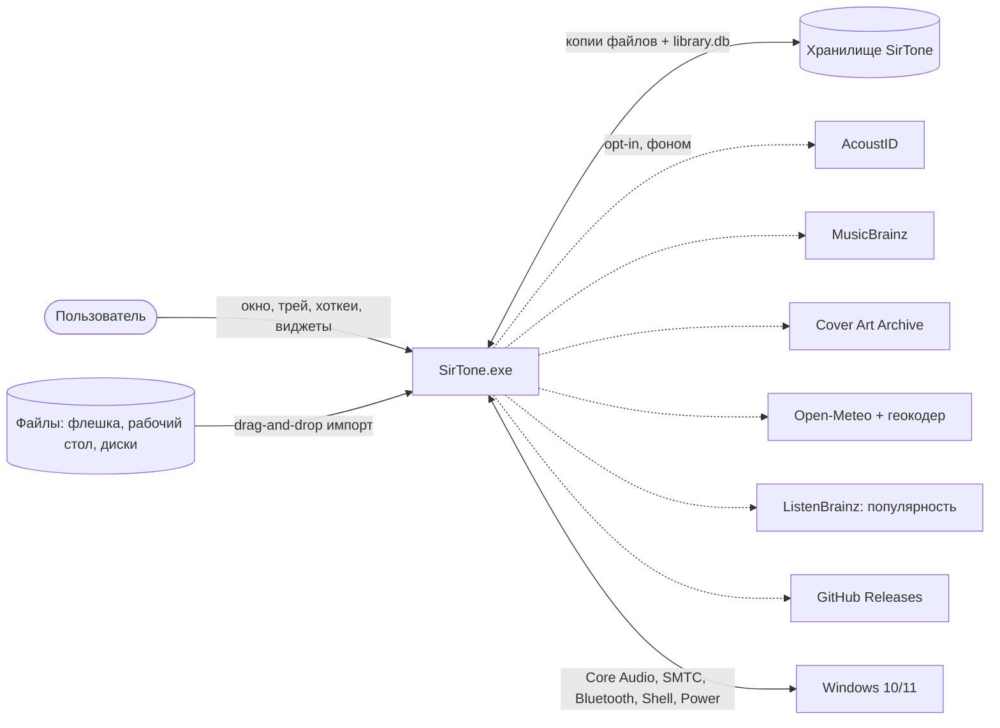
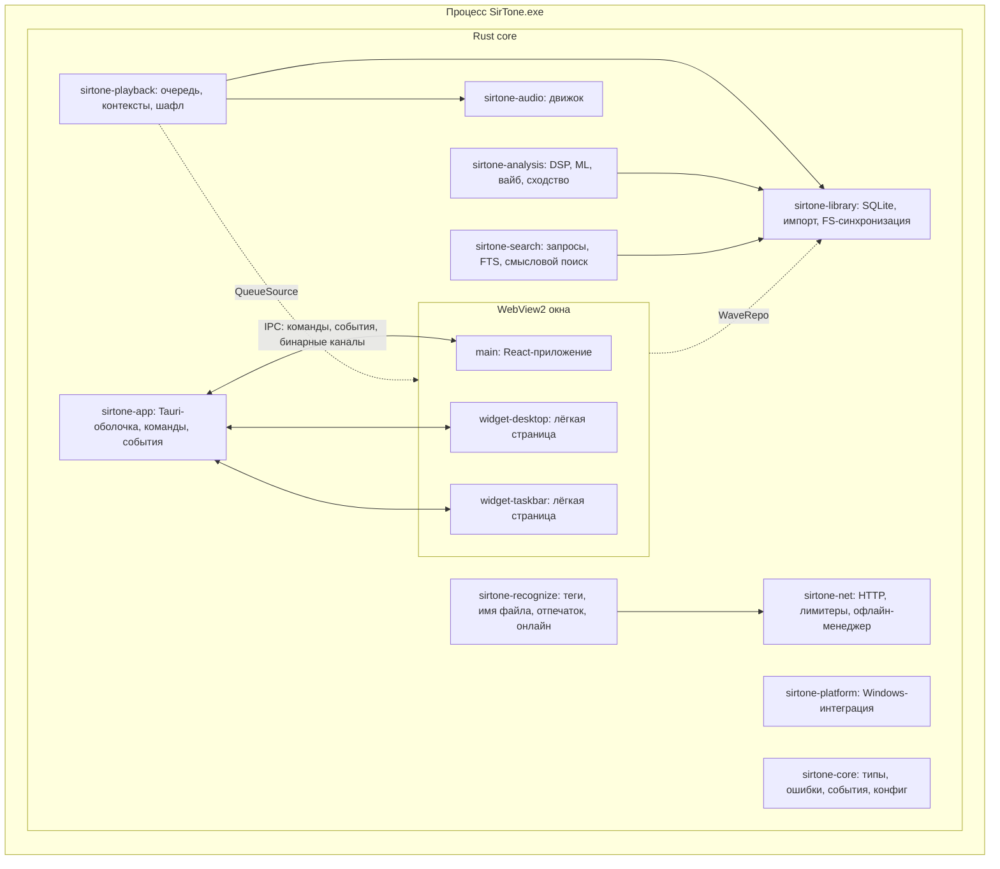
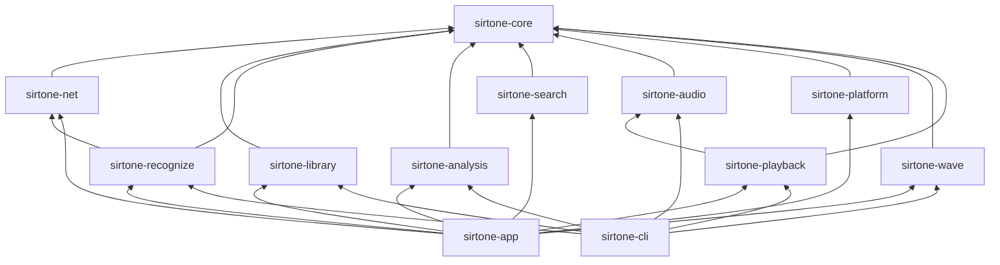
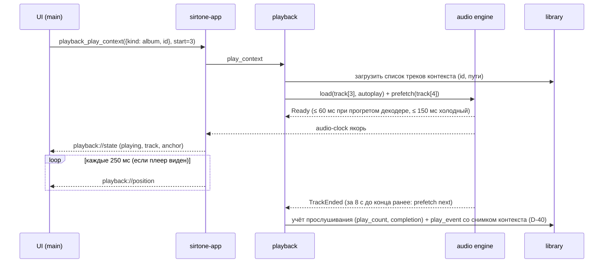
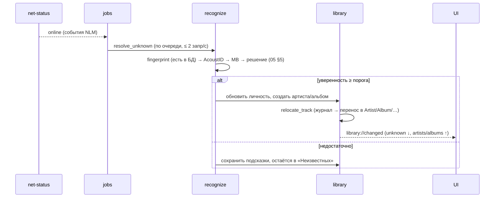

# 03. Архитектура SirTone

> Версия 1.3 · 2026-10-16 · статус: **утверждено к реализации** (изменения — только через ADR в `10_DECISIONS.md`)
> Связанные документы: `02_TZ.md` (что строим) · `04_AUDIO_AND_ANALYSIS.md` · `05_LIBRARY_AND_RECOGNITION.md` · `06_UX_AND_VISUALIZATION.md` · `07_WINDOWS_INTEGRATION.md` · **`14_WAVE_ENGINE.md` (движок волны, сезоны, события, режимы)**

Обозначения: ✅ утверждено владельцем (исходное ТЗ) · 🔧 решение проектировщика (меняется через ADR) · 🧪 проверяется спайком до фиксации (см. `09_ROADMAP.md`) · ❓ нужен ответ владельца.

---

## 0. Основание: чьи решения мы повторяем

Принцип владельца — **не изобретать, а копировать то, что работает у популярных приложений** (`01_RESEARCH.md`). Архитектурные решения ниже прямо опираются на референсы (`01a` §C):

| Решение | Референсы (≥ 6) |
|---|---|
| Нативное ядро отдельно от веб-UI; UI не играет звук | Spotify (CEF + нативный контейнер), Plexamp (Electron + MPD), Roon (Core/Remote/Output), WaveFlow, LUMEN, MPD |
| Конвейер *decode → resample → DSP → output*, vis — ответвление после DSP | VLC, MPD, Winamp, GStreamer/Strawberry, foobar2000, MusicBee |
| Вывод — сменный модуль (WASAPI shared/exclusive) | MusicBee, MPD, VLC |
| Gapless через предоткрытие следующего трека | LUMEN, GStreamer, MPD |
| Библиотека — SQLite (+FTS5), а не база в памяти | foobar2000 v2 (ушёл от in-memory), Strawberry, Navidrome, WaveFlow, LUMEN |
| Сканер + watcher + состояние `missing` со статистикой | Navidrome, Plex, WMP monitored folders |
| События вместо опроса, но **асинхронные** | foobar2000 `play_callback`, MusicBee notifications (синхронные обработчики блокируют плеер — не повторяем) |
| Портативность: маркер-файл, всё в папке, без реестра | foobar2000, AIMP/MusicBee Portable |
| Обновления: фон → установка при выходе/по кнопке | electron-updater, Squirrel, Omaha, Tauri Updater |
| Рекомендации: кандидаты → ранжирование → секвенсор; Томпсон-сэмплинг; объяснения из вкладов (`14`, D-38/D-39) | YouTube (Covington 2016), Spotify BaRT/EEE, Deezer (бандиты), Chapelle & Li, Pandora, Roon/Plexamp (офлайн-радио) |

Что **не** копируем: динамически подгружаемые плагины (foobar2000/Winamp/AIMP/VLC) — в v1 модули связаны трейтами на этапе компиляции; WASM-плагины (WaveFlow) — вне скоупа.

---

## 1. Архитектурные принципы

1. **Rust — источник истины.** Всё состояние (воспроизведение, очередь, библиотека, задачи, настройки, уровень производительности) живёт в Rust. Фронтенд — тонкий слой отображения: получает снимки и диффы по событиям, отправляет команды, держит только эфемерный UI-state.
2. **Доменные крейты не знают о Tauri.** Аудиодвижок, библиотека, распознавание и анализ запускаются без UI (CLI-харнесс `sirtone-cli`) — это даёт тесты, бенчмарки и отладку без WebView.
3. **Реальное время неприкосновенно.** Аудио-поток не аллоцирует память, не берёт мьютексы, не пишет в лог и не ждёт ввода-вывода.
4. **Прогрессивное улучшение.** Трек доступен для воспроизведения сразу после копирования в хранилище; отпечаток, онлайн-распознавание, анализ, обложки дозаполняются фоном и «доезжают» в UI событиями.
5. **Всё тяжёлое — в персистентной очереди задач** с приоритетами, троттлингом и возобновлением после перезапуска. UI никогда не ждёт задачу.
6. **Любая тяжёлая функция отключаема и деградирует** (пресеты производительности, `06` §6). «Очень слабое» = почти голый плеер.
7. **Офлайн по умолчанию.** Сеть — улучшение, не зависимость. Единый сетевой слой, мастер-выключатель «Работать полностью офлайн».
8. **Данные пользователя неприкосновенны.** Аудио не перекодируется и не изменяется; удаление — через Корзину Windows; перемещения файлов — через журнал (crash-safe); ничего не удаляется «тихо», если ситуация неоднозначна.
9. **Один пользователь — одна библиотека** ✅. Никаких профилей, синхронизации, бэкапов (ТЗ §20).

---

## 2. Контекст и контейнеры

### 2.1. Контекст (C4, уровень 1)



Пунктир — необязательные сетевые вызовы (выключаются мастер-тумблером офлайн-режима).

### 2.2. Контейнеры (уровень 2)

Один процесс Tauri 2 (Rust) + дочерние процессы WebView2 (browser/renderer/gpu/utility — управляются Edge).



Стрелки на этой схеме — потоки данных; зависимости крейтов — только через трейты `core` (§3.1).

**Окна:**

| Окно (label) | Назначение | Жизненный цикл |
|---|---|---|
| `main` | Основное приложение, весь функционал | Создаётся на старте; при закрытии (крестик) скрывается и сразу усыпляется (`IsVisible=false` + `TrySuspend`, D-52); после 60 с в трее WebView уничтожается для экономии памяти (🔧 настройка «Быстро открывать»); при открытии — пересоздаётся со скелетоном ≤ 100 мс |
| `widget-desktop` | Виджет на рабочем столе (`07` §5) | Живёт, пока включён; маленькая отдельная страница (≤ 100 КБ JS) |
| `widget-taskbar` | Мини-бар у панели задач (`07` §4) | Аналогично |
| `fullscreen vibe` | Не отдельное окно — режим `main` | — |

Закрытие `main` не останавливает ядро: музыка, горячие клавиши, трей и виджеты продолжают работать ✅.

---

## 3. Раскладка репозитория

```
SirTone/
├─ Cargo.toml                    # workspace
├─ pnpm-workspace.yaml
├─ package.json                  # корневые скрипты (lint, test, tauri)
├─ CLAUDE.md                     # правила для Claude Code
├─ deny.toml  rustfmt.toml  clippy.toml  biome.json  .editorconfig  .gitattributes  .gitignore  .mcp.json
├─ apps/
│  └─ desktop/
│     ├─ src/                    # React-фронтенд (feature-sliced, см. §3.2)
│     ├─ widgets/                # отдельные точки входа: desktop.html, taskbar.html
│     ├─ src-tauri/              # крейт sirtone-app (единственный, кто знает Tauri)
│     │  ├─ tauri.conf.json  capabilities/*.json  icons/
│     │  └─ src/ (commands/, events.rs, state.rs, windows/, tray.rs, protocols.rs, main.rs)
│     └─ index.html
├─ crates/
│  ├─ sirtone-core/              # доменные типы, ID, ошибки, события, схема настроек
│  ├─ sirtone-net/               # HTTP-клиент, лимитеры, кэш ответов, офлайн-менеджер
│  ├─ sirtone-library/           # SQLite, миграции, репозитории, импорт, раскладка, watcher, дубли, экспорт
│  ├─ sirtone-recognize/         # парсинг тегов/имён, отпечаток, AcoustID/MB/CAA, модель уверенности
│  ├─ sirtone-analysis/          # громкость, пики, BPM/тональность, ML-инференс, вайб, сходство
│  ├─ sirtone-search/            # нормализация запросов, FTS, нечёткий и смысловой поиск, лексикон
│  ├─ sirtone-audio/             # декодирование, ресемплинг, DSP, микшер, автомикс, вывод WASAPI
│  ├─ sirtone-playback/          # контроллер: очередь, контексты, шафл, повтор, гибридные продолжения, сон/фокус-таймеры (исполнение)
│  ├─ sirtone-wave/              # движок волны: часы, календарь, контекст, профили, скоринг, секвенсор, обучение, сезоны, события, темы (14)
│  ├─ sirtone-platform/          # Windows: SMTC, панель задач, ducking, звонки, Bluetooth, питание (экран/сон), ввод, геолокация
│  └─ sirtone-cli/               # харнесс: play, render, import, analyze, bench, wave simulate (только dev)
├─ assets/
│  ├─ models/                    # ONNX + MODELS.md (источник, лицензия, sha256)
│  ├─ viz/                       # индекс пресетов, палитры, шейдеры
│  ├─ i18n/                      # ru.json, en.json
│  ├─ sfx/                       # звуки интерфейса
│  ├─ lexicon/                   # словари смыслового поиска (ru.json, en.json)
│  └─ wave/                      # профили волн, сезоны, календарь событий, словари, тоны, темы, эффекты (14 §22)
├─ spikes/                       # самостоятельные прототипы спайков (S-17 …), не входят в workspace
├─ tools/                        # dev-инструменты: fixtures, golden-set, preset-indexer, synth-library (бенч движка волны)
├─ scripts/                      # dev-env.ps1, release.ps1, check-all.ps1
├─ docs/                         # эта документация
└─ .github/workflows/            # ci.yml, release.yml
```

### 3.1. Крейты и правила зависимостей



Жёсткие правила (проверяются `cargo deny` + `cargo tree` в CI):

- `sirtone-audio`, `sirtone-analysis`, `sirtone-search`, `sirtone-recognize`, `sirtone-wave` **не зависят друг от друга** (общение через трейты из `core` — `WaveRepo`, `QueueSource`, `PlaybackControl`, `PowerActions`, `UserActivity`, `CallSignal` — и сборку в `app`; `14` §2.1).
- Доменные крейты **не зависят от `tauri`**. Ни один не тянет `windows` напрямую, кроме `platform` и `audio` (WASAPI).
- `sirtone-library` — единственный владелец SQLite-соединений. Остальные получают данные через трейты (`TrackRepo`, `ArtistRepo`, …) из `core`.
- Любая публичная функция, вызываемая из аудио-потока, помечена `#[inline]`/документирована как RT-safe; в RT-путях запрещены `Vec::push` с ростом, `Mutex`, `println!`, `tracing::*` (кроме compile-time disabled), `Box::new` и т.п.

### 3.2. Фронтенд (React 19 + TS + Vite + Tailwind 4 + shadcn/ui)

```
src/
├─ app/            # корень: провайдеры (i18n, theme, perf, query), роутинг-стек, shell
├─ shared/
│  ├─ ipc/         # сгенерированные биндинги + обёртки invoke/listen, кэш, дедупликация запросов
│  ├─ ui/          # shadcn-компоненты (переопределяемые токенами дизайна владельца)
│  ├─ motion/      # токены анимаций, хуки useMotionBudget/usePerf
│  ├─ i18n/        # инициализация, форматтеры, плюрали
│  ├─ virtual/     # VirtualList/VirtualGrid поверх @tanstack/react-virtual
│  └─ lib/         # утилиты (цвет OKLCH, форматирование времени/размера)
├─ features/       # wave (+ «Настроить волну», чипы, «Мои волны»), collection, playlists, search, unknown, import, settings,
│                  # onboarding, viz, fx (живые эффекты), sleep, focus, events (карточки), eq, bluetooth
├─ entities/       # track, album, artist, playlist: типы, ячейки, карточки
└─ widgets/        # отдельные страницы виджетов (общий минимальный код)
```

Правила: нет прямых вызовов `invoke` вне `shared/ipc`; нет строковых литералов в JSX (ESLint `i18next/no-literal-string`); нет обновлений CSS-переменных корня чаще 4 раз в секунду (урок LUMEN: 50-мс перерисовка корня съедала память) — всё высокочастотное рисуется в `<canvas>`/WebGL.

---

## 4. Модель выполнения

| Поток / пул | Приоритет | Что делает | Ограничения |
|---|---|---|---|
| **UI thread** (tao event loop) | normal | события окон, трей, глобальные хоткеи (колбэки), системные сообщения | Не блокировать: любые команды > 5 мс уходят в пулы |
| **Tokio runtime** (2–4 воркера) | normal | async-команды IPC, HTTP, таймеры, оркестрация задач | `spawn_blocking` для SQLite и файлового ввода-вывода |
| **Audio render thread** | MMCSS «Pro Audio» | WASAPI event-driven: копирует готовые кадры из кольца в буфер устройства, применяет «позднюю» громкость | RT-safe, ≤ 50 µs на колбэк |
| **Engine thread** | above normal | декодеры, ресемплер, DSP, микшер/автомикс, лимитер → кольцо вывода; обработка команд движка | не блокируется на IO дольше 1 мс (чтение декодером идёт через предзаполняемые буферы) |
| **Decoder threads** (по одному на «деку», до 2) | normal | чтение файла, декодирование в предзаполненное кольцо (2–4 с) | `catch_unwind`: паника парсера = ошибка трека, не краш приложения |
| **Analysis pool** (rayon) | below normal + EcoQoS | отпечаток, громкость, BPM/ключ, ML, пики | размер пула динамический (§11.3), приостановка по батарее/полноэкранной игре |
| **Wave worker** (1 поток) | normal | движок волны: пересборка очереди (≈ 3 мс на 50 000), обновление моделей, таймеры сна/фокуса (планы), события и темы | не блокирует UI и движок; запись в БД — батчами через DB writer (`14` §2.2) |
| **DB writer** (1 поток) | normal | сериализованные записи SQLite (WAL), батчи | единственный писатель, очередь команд |
| **DB readers** (пул 4) | normal | чтение для UI (списки, поиск) | только read-only соединения |
| **FS watcher** | below normal | `ReadDirectoryChangesW` через `notify` + дебаунс | события → очередь «reconcile» |
| **Platform threads** (COM MTA) | normal | Core Audio сессии/устройства, SMTC, Bluetooth-наблюдатели, питание | события → в `sirtone-app` через каналы |

**Каналы:** `crossbeam-channel` (ограниченные) между потоками; `tokio::sync::{mpsc, watch, broadcast}` в async-мире; `rtrb` (SPSC lock-free) для аудио. Широковещание событий в UI — единый `EventBus` в `app`, буферизующий и склеивающий частые события (позиция, прогресс).

---

## 5. Контракт IPC (Rust ↔ WebView)

### 5.1. Общие соглашения

- Команды Tauri: `snake_case`, префикс домена — `playback_*`, `audio_*`, `library_*`, `import_*`, `unknown_*`, `playlist_*`, `search_*`, `wave_*`, `viz_*`, `settings_*`, `perf_*`, `platform_*`, `app_*`, `jobs_*`, `net_*`.
- Типы: **генерируются из Rust** (🔧 `tauri-specta` 2.0.0-rc.25 + `specta`; 🧪 в E0.2 подтвердить совместимость с Tauri 2.12; запасной вариант — `ts-rs` 12 + ручные тонкие обёртки). Ручные TS-типы IPC запрещены. CI падает, если сгенерированные биндинги отличаются от закоммиченных.
- Идентификаторы в IPC — числовые `id` (i64) для быстрых запросов; `uid` (UUID v7) только для экспорта/межбиблиотечных ссылок.
- Время — `i64` unix-ms UTC; длительности — `u32` миллисекунды; громкость — `f32` 0..1 (линейная шкала UI, не dB).
- Полезная нагрузка: типично ≤ 64 КБ, жёстко ≤ 1 МБ. Большие/частые потоки — только бинарные `Channel`.

### 5.2. Каталог команд (v1)

| Домен | Команды (сокращённо) |
|---|---|
| playback | `play_context(ctx, start)`, `toggle`, `pause`, `resume`, `next`, `prev`, `seek(ms)`, `set_volume`, `set_mute`, `queue_add(next/last)`, `queue_remove`, `queue_move`, `queue_clear`, `set_repeat`, `set_shuffle`, `get_state` |
| audio | `list_devices`, `set_output(device, exclusive)`, `set_eq`, `set_normalization`, `set_automix`, `set_duck`, `get_signal_path`, `play_sfx(id)` |
| library | `get_overview` (счётчики, длительность, вес), `list_tracks(query, range)`, `list_artists/albums/genres/moods`, `get_track/album/artist`, `update_track(patch)`, `move_track(target)`, `delete_tracks(ids, mode: file/library_only)`, `merge_artists`, `set_cover(album, source)`, `get_storage_stats`, `export(selection, target, options)` |
| import | `start(paths[])`, `cancel(batch)`, `get_report(batch)`, `resolve_duplicates(batch, decisions[])` |
| unknown | `list`, `accept_suggestion`, `assign(fields)`, `mark_normal`, `retry_online` |
| playlist | `list`, `get`, `create(kind, name, rules?)`, `update`, `delete`, `add_tracks`, `remove_items`, `reorder`, `preview_hybrid(id)` |
| search | `query(q, limits)`, `suggest(q)` |
| wave | `get_options`, `start(profile_id, overrides?)`, `update(wave_query)`, `get_context` (время суток, погода, занятие, сезон, события), `set_novelty`, `get_composition`, `toggle_influence`, `why(track)`, `feedback(kind)`, `tag_track`, `profiles_*`, `learning_*` — полный список `14` §19 |
| events / timers | `events_list`, `events_set_pref`, `events_suggestion_action`; `sleep_start/extend/cancel/get`; `focus_start/pause/resume/skip/stop/get` |
| theme / fx | `theme_get_state`, `theme_set_override`, `fx_get_state`, `fx_set_mode` |
| viz | `subscribe(channel)`, `unsubscribe`, `get_vibe(track)`, `get_palette(track)`, `pick_preset(vibe)`, `get_user_color` |
| settings / perf | `settings_get`, `settings_patch`, `perf_get_state`, `perf_detect`, `perf_set_level`, `perf_restore` |
| platform | `hotkeys_get/set`, `bluetooth_list/connect/disconnect/open_system`, `widgets_set`, `autostart_set`, `geo_set_city`, `geo_search_city` |
| app | `bootstrap` (первичная гидратация UI), `check_update`, `install_update`, `get_about`, `quit` |
| jobs / net | `jobs_status`, `jobs_pause/resume`, `net_status`, `net_set_offline(bool)` |

Каждая команда: идемпотентна там, где возможно; возвращает `Result<T, AppError>`; отменяема, если долгая (токен отмены).

### 5.3. События (Rust → UI)

Все события **асинхронные и буферизуются** (урок MusicBee: синхронный обработчик блокирует плеер). Частые события (позиция, прогресс) склеиваются; при пересоздании окна состояние восстанавливается `app_bootstrap`.

| Событие | Частота | Полезная нагрузка |
|---|---|---|
| `playback://state` | по изменению | play/pause/idle/buffering, текущий трек, позиция-якорь, repeat/shuffle |
| `playback://position` | 4 Гц при показе плеера (иначе реже/выкл.) | position_ms (UI интерполирует между событиями) |
| `playback://queue` | по изменению | версия очереди + дифф |
| `library://changed` | с дебаунсом 150 мс | `scope`: `tracks`/`artists`/`albums`/`playlists`/`unknown`/`stats` + диапазон затронутых id |
| `import://progress` | ≤ 10 Гц | batch, фаза, готово/всего, текущий файл, счётчики |
| `jobs://status` | ≤ 2 Гц | очередь по типам, активные, ожидающие, пауза/офлайн |
| `net://status` | по изменению | online/offline, причина |
| `audio://device` | по изменению | смена/потеря устройства, режим вывода |
| `perf://level` | по изменению | текущий уровень, причина понижения, флаг «понижено автоматически» |
| `settings://changed` | по изменению | изменённые ключи |
| `platform://hotkey-conflict` | редко | какой хоткей не зарегистрирован |
| `update://available` | редко | версия, заметки |
| `wave://composition`, `wave://relaxed`, `wave://suggestion` | по изменению | чипы влияний; шаги ослабления; карточка события |
| `timer://sleep`, `timer://focus` | 1 Гц при активном таймере | фаза, остаток, «проснулся»; цикл, счётчик за сегодня |
| `theme://state`, `fx://state`, `weather://state` | по изменению (тема — не чаще 1 раза в сутки в межсезонье) | исходный цвет и палитра; тип/плотность/ветер эффекта; погода и её свежесть |

### 5.4. Бинарные каналы (Tauri `Channel`)

- **`viz` (60 Гц max):** кадр визуализации (формат — `04` §9): заголовок 32 Б (версия, флаги, `t_audio_ms`, `beat_phase`, `bpm`, `bands[3]`) + `u8[1024]` mono + `u8[1024]` L + `u8[1024]` R со смещением 128 (формат Butterchurn `timeByteArray*`) ≈ 3,1 КБ/кадр ≈ 190 КБ/с. Без base64 — сырые байты (`InvokeResponseBody::Raw`) 🧪(S-04). Для справки: обсуждение Tauri показывает, что бинарный IPC на Windows/WebView2 может быть медленным на МБ-размерах — наш кадр ~3 КБ.
- **Обложки не идут через IPC** — только через кастомный протокол (§5.6).

### 5.5. Модель ошибок

```rust
pub struct AppError {
    pub code: ErrorCode,          // стабильный enum, не меняется между версиями
    pub retryable: bool,
    pub details: Option<serde_json::Value>,  // для лога/диагностики, не для показа
}
```

Коды (расширяемый список): `FileNotFound`, `UnsupportedFormat`, `DecodeFailed`, `PathTooLong`, `DiskFull`, `PermissionDenied`, `DeviceUnavailable`, `DeviceBusy`, `NetworkOffline`, `RateLimited`, `RemoteError`, `DbBusy`, `DbCorrupt`, `Cancelled`, `InvalidArgument`, `LibraryOffline` (корень недоступен, например флешка вынута), `NotSupported` (действие недоступно на этом ПК — например, сон на Modern Standby), `InvalidConfig` (битый профиль волны/календарь — откат к встроенным), `Internal`. **Тексты для пользователя формирует UI по `code`** через i18n (`errors.<code>`); Rust не отдаёт локализованных строк.

### 5.6. Кастомные протоколы (ассеты без IPC)

| Схема | Назначение | Кэширование |
|---|---|---|
| `sirtone-cover://<hash>/<size>` (Windows: `http://sirtone-cover.localhost/<hash>/<size>`) | Обложки заданного размера (64/128/256/512/1024), лениво генерируются в WebP из оригинала, дедуп параллельных запросов | `Cache-Control: immutable` (хэш в URL) |
| `sirtone-bg://<id>` | Фоновые видео/пользовательские ролики | Range-запросы для `<video>` |

Протоколы отдают только файлы из белых списков каталогов (кэш обложек, `backgrounds/`); любые `..` и абсолютные пути отклоняются.

---

## 6. Владение состоянием и синхронизация UI

| Данные | Владелец | В UI |
|---|---|---|
| Воспроизведение, очередь, громкость, EQ | Rust (`playback`/`audio`) | снимок + события; позиция интерполируется на клиенте |
| Библиотека (треки, альбомы, исполнители, плейлисты) | Rust (`library`, SQLite) | постраничные запросы + кэш по `(queryKey, pageIndex)` в памяти WebView; инвалидация событием `library://changed` |
| Настройки | Rust (`settings.json` с версией схемы) | `settings_get` на старте + `settings://changed` |
| Уровень производительности | Rust (`perf`) + замеры из UI (кадры) отправляются в Rust | CSS-переменные/контекст React на основе события |
| Волна: профиль, контекст, модели, таймеры сна/фокуса, активная тема, состояние эффекта | Rust (`wave`, поток `wave-worker`) | события `wave://*`, `timer://*`, `theme://state`, `fx://state`; цвета считает UI из исходного цвета (`06` §4.2), частицы рисует UI (`06` §7.7) |
| Навигация, выделение, скролл, открытые панели | UI | не сохраняется между запусками ✅ (сессия не восстанавливается) |

**Гидратация:** при (пере)создании окна UI вызывает `app_bootstrap` и получает: настройки, снимок плеера, счётчики, статус задач/сети/перф — окно рисует «живое» состояние за один кадр.

---

## 7. Модель данных (SQLite)

Движок: SQLite (bundled, ≥ 3.45, FTS5), через `rusqlite` 0.40 (🔧 sync-API, полный контроль над соединениями и транзакциями; миграции — `rusqlite_migration`). Режим: `journal_mode=WAL`, `synchronous=NORMAL`, `foreign_keys=ON`, `temp_store=MEMORY`, `mmap_size=256MB`, `cache_size=-65536` (64 МБ). **На съёмных носителях** (`GetDriveType == DRIVE_REMOVABLE`, портативный режим с флешки): `journal_mode=DELETE`, `synchronous=FULL` — без `-wal/-shm`, безопаснее при выдёргивании 🔧.

Время — INTEGER unix-ms UTC; булевы — INTEGER 0/1; нормализованные строки (`*_norm`) — см. `05` §1.

```sql
-- migrations/0001_init.sql (основные таблицы; полный DDL — в crate при реализации)

CREATE TABLE meta (key TEXT PRIMARY KEY, value TEXT NOT NULL) WITHOUT ROWID;
-- ключи: schema_version, library_uid, created_at, analysis_version, layout_template

CREATE TABLE artist (
  id          INTEGER PRIMARY KEY,
  uid         TEXT NOT NULL UNIQUE,
  name        TEXT NOT NULL,
  name_norm   TEXT NOT NULL,
  sort_name   TEXT,
  mbid        TEXT,
  kind        TEXT NOT NULL DEFAULT 'artist' CHECK (kind IN ('artist','various','unknown')),
  merged_into INTEGER REFERENCES artist(id),          -- мягкое слияние: NULL = каноническая запись
  folder_name TEXT,                                   -- имя папки на диске (после санитизации)
  created_at  INTEGER NOT NULL
);
CREATE UNIQUE INDEX ux_artist_norm ON artist(name_norm) WHERE merged_into IS NULL;

CREATE TABLE artist_alias (
  alias_norm TEXT PRIMARY KEY,
  artist_id  INTEGER NOT NULL REFERENCES artist(id) ON DELETE CASCADE,
  source     TEXT NOT NULL CHECK (source IN ('merge','translit','musicbrainz','user'))
) WITHOUT ROWID;

CREATE TABLE cover (
  id INTEGER PRIMARY KEY, hash TEXT NOT NULL UNIQUE,
  source TEXT NOT NULL CHECK (source IN ('embedded','folder','caa','user','generated')),
  width INTEGER, height INTEGER,
  palette TEXT,                                       -- JSON: 3–5 доминирующих цветов (OKLCH)
  created_at INTEGER NOT NULL
);

CREATE TABLE album (
  id INTEGER PRIMARY KEY, uid TEXT NOT NULL UNIQUE,
  title TEXT NOT NULL, title_norm TEXT NOT NULL,
  album_artist_id INTEGER NOT NULL REFERENCES artist(id),
  year INTEGER,
  kind TEXT NOT NULL DEFAULT 'album' CHECK (kind IN ('album','single','ep','compilation','unknown')),
  mbid_release TEXT, mbid_group TEXT,
  disc_count INTEGER NOT NULL DEFAULT 1,
  cover_id INTEGER REFERENCES cover(id),
  cover_locked INTEGER NOT NULL DEFAULT 0,            -- 1 = обложку выбрал пользователь (ТЗ §13)
  lufs_album REAL,                                    -- громкость альбома целиком (нормализация «по альбому»)
  folder_name TEXT, created_at INTEGER NOT NULL
);
CREATE INDEX ix_album_artist ON album(album_artist_id, title_norm);

CREATE TABLE track (
  id INTEGER PRIMARY KEY, uid TEXT NOT NULL UNIQUE,
  rel_path TEXT NOT NULL UNIQUE,                      -- относительно корня библиотеки, разделитель '/', NFC
  size_bytes INTEGER NOT NULL, mtime_ms INTEGER NOT NULL,
  file_id TEXT,                                       -- NTFS FileId (том:индекс), если доступен
  content_hash TEXT NOT NULL,                         -- BLAKE3 всего файла (считается при копировании)
  container TEXT NOT NULL, codec TEXT NOT NULL, lossless INTEGER NOT NULL,
  sample_rate INTEGER, bit_depth INTEGER, channels INTEGER, bitrate_kbps INTEGER,
  duration_ms INTEGER NOT NULL,
  -- идентичность
  title TEXT NOT NULL, title_norm TEXT NOT NULL,
  album_id INTEGER REFERENCES album(id), disc_no INTEGER, track_no INTEGER, year INTEGER,
  genre_main TEXT,                                    -- из контролируемого словаря (05 §6)
  identity_state TEXT NOT NULL CHECK (identity_state IN ('confirmed','inferred','user','unknown')),
  identity_conf REAL NOT NULL DEFAULT 0,
  unknown_reason TEXT,                                -- no_metadata|conflict|low_confidence|offline_pending|possible_non_track|needs_review
  candidates_json TEXT,                               -- подсказки для раздела «Неизвестные»
  mbid_recording TEXT,
  user_normal INTEGER NOT NULL DEFAULT 0,             -- «пометить как нормальный» (ТЗ §7.5)
  no_mix INTEGER NOT NULL DEFAULT 0,                  -- не микшировать этот трек (автомикс)
  -- громкость и форма
  lufs_i REAL, true_peak_db REAL, lra REAL,
  peaks BLOB,                                         -- u8[400] обзор волны для таймлайна
  lead_silence_ms INTEGER, tail_silence_ms INTEGER,   -- порог −60 dBFS (как Mixxx Skip Silence)
  env_head BLOB, env_tail BLOB,                       -- u8 dB, 10 Гц, первые/последние 30 с (как «10 выборок/с» Plexamp) — для перекрытия
  -- темп и тональность
  bpm REAL, bpm_conf REAL, beat_grid BLOB, grid_stability REAL,   -- beat_grid: u32 delta-ms, сжато
  key_camelot TEXT, key_conf REAL,
  -- вайб (04 §6)
  valence REAL, arousal REAL, aggression REAL, energy REAL,
  danceability REAL, acousticness REAL, vocal REAL,
  lang TEXT CHECK (lang IN ('ru','foreign','none','unknown')), lang_conf REAL,
  mood_bits INTEGER NOT NULL DEFAULT 0,               -- битовая маска настроений для быстрых фильтров
  activity_json TEXT,                                 -- {"work":0.7,"workout":0.1,...}
  embedding BLOB,                                     -- i8[64] + масштаб
  fingerprint BLOB, fp_duration_ms INTEGER,           -- Chromaprint, сжатый
  analysis_version INTEGER NOT NULL DEFAULT 0, analyzed_at INTEGER,
  -- невидимая агрегированная статистика (ТЗ §22, вопрос 6)
  play_count INTEGER NOT NULL DEFAULT 0, skip_count INTEGER NOT NULL DEFAULT 0,
  last_played_at INTEGER, completion_ema REAL NOT NULL DEFAULT 0,
  plays_recent BLOB,                                  -- u8[13] недельные корзины за 13 недель (для «часто слушаю» без журнала событий)
  added_at INTEGER NOT NULL, import_batch_id INTEGER REFERENCES import_batch(id),
  state TEXT NOT NULL DEFAULT 'ok' CHECK (state IN ('ok','missing','quarantined'))
);
CREATE INDEX ix_track_album    ON track(album_id, disc_no, track_no);
CREATE INDEX ix_track_identity ON track(identity_state, unknown_reason);
CREATE INDEX ix_track_added    ON track(added_at DESC);
CREATE INDEX ix_track_played   ON track(last_played_at);
CREATE INDEX ix_track_hash     ON track(content_hash);
CREATE INDEX ix_track_dur      ON track(duration_ms);        -- кандидаты дублей (05 §8)
CREATE INDEX ix_track_fileid   ON track(file_id) WHERE file_id IS NOT NULL;

CREATE TABLE track_artist (
  track_id  INTEGER NOT NULL REFERENCES track(id) ON DELETE CASCADE,
  artist_id INTEGER NOT NULL REFERENCES artist(id),
  role      TEXT NOT NULL CHECK (role IN ('primary','featured','album')),
  position  INTEGER NOT NULL,                          -- порядок в названии; primary = первый
  PRIMARY KEY (track_id, artist_id, role)
) WITHOUT ROWID;
CREATE INDEX ix_ta_artist ON track_artist(artist_id);

CREATE TABLE playlist (
  id INTEGER PRIMARY KEY, uid TEXT NOT NULL UNIQUE, name TEXT NOT NULL,
  kind TEXT NOT NULL CHECK (kind IN ('manual','smart')),
  rules_json TEXT,                                    -- AST правил для smart (05 §10)
  hybrid INTEGER NOT NULL DEFAULT 0,                  -- продолжать похожими из медиатеки (ТЗ §8)
  cover_id INTEGER REFERENCES cover(id), sort_order INTEGER NOT NULL DEFAULT 0,
  created_at INTEGER NOT NULL, updated_at INTEGER NOT NULL
);
CREATE TABLE playlist_item (
  playlist_id INTEGER NOT NULL REFERENCES playlist(id) ON DELETE CASCADE,
  position INTEGER NOT NULL, track_id INTEGER NOT NULL REFERENCES track(id) ON DELETE CASCADE,
  added_at INTEGER NOT NULL, PRIMARY KEY (playlist_id, position)
) WITHOUT ROWID;
CREATE INDEX ix_pi_track ON playlist_item(track_id);

CREATE TABLE import_batch (
  id INTEGER PRIMARY KEY, started_at INTEGER NOT NULL, finished_at INTEGER,
  source TEXT NOT NULL CHECK (source IN ('drop','watch','external')),
  stats_json TEXT, report_json TEXT                   -- отчёт о дублях и итогах (ТЗ §7.6)
);

CREATE TABLE job (
  id INTEGER PRIMARY KEY, kind TEXT NOT NULL, payload_json TEXT NOT NULL,
  track_id INTEGER, priority INTEGER NOT NULL DEFAULT 50,      -- меньше = важнее
  state TEXT NOT NULL DEFAULT 'queued' CHECK (state IN ('queued','running','done','failed','paused')),
  attempts INTEGER NOT NULL DEFAULT 0, next_run_at INTEGER NOT NULL DEFAULT 0, last_error TEXT,
  created_at INTEGER NOT NULL
);
CREATE INDEX ix_job_pick ON job(state, priority, next_run_at);

CREATE TABLE fs_journal (                                -- crash-safe перемещения/удаления (§8)
  id INTEGER PRIMARY KEY, op TEXT NOT NULL CHECK (op IN ('copy','move','trash')),
  src TEXT NOT NULL, dst TEXT, state TEXT NOT NULL CHECK (state IN ('planned','done','rolled_back')),
  ts INTEGER NOT NULL
);

CREATE TABLE http_cache (key TEXT PRIMARY KEY, body BLOB NOT NULL, fetched_at INTEGER NOT NULL,
  ttl_s INTEGER NOT NULL, etag TEXT) WITHOUT ROWID;

-- Поиск (05 §11): две контентless-таблицы, обновляются из кода импорта/правок
CREATE VIRTUAL TABLE search_fts USING fts5(title, artists, album, genre, aliases,
  content='', tokenize='unicode61 remove_diacritics 2');
CREATE VIRTUAL TABLE search_tri USING fts5(text, content='', tokenize='trigram');
```

### 7.1. Данные движка волны (миграция `0002_wave.sql`, Этап 1)

Полный DDL — `14` §18.1: колонки `track.liked_at`, `track.wave_never`, `track.explicit`, `artist.wave_never`; таблицы `track_features` (вектор 32×f32, сезонные аффинности), `track_tag` (ручные метки), `play_event` + `play_event_rollup` (журнал прослушиваний со снимком контекста, свёртка через 2 года — D-40), `feedback`, `track_affinity` (бета по моделям), `taste_model`, `wave_profile`, `event_pref`/`event_state`, `theme_preset`, `weather_cache`, `popularity_cache`, `wave_state`. Все — в `library.db` рядом с медиатекой (в портативной версии — на флешке).

**Индексы под списки:** все постраничные запросы используют keyset-пагинацию (`WHERE (sort_key, id) > (?, ?) ORDER BY … LIMIT 100`) по покрывающим индексам; `COUNT(*)` для текущего фильтра кэшируется до следующего `library://changed`. Цель: страница из 100 строк ≤ 10 мс на 100 000 треков.

**Миграции:** только вперёд; версия в `PRAGMA user_version` и `meta.schema_version`; перед миграцией — копия `library.db` в `.sirtone/backup/library-<ver>.db` (хранится 1 штука; это защита от сбоя миграции, а не «встроенный бэкап библиотеки», который вне скоупа ✅).

---

## 8. Файловая раскладка и режимы запуска

### 8.1. Хранилище (корень библиотеки)

```
<LibraryRoot>\
├─ <Исполнитель>\<Альбом>\<NN - Название>.<ext>     ← видно в проводнике ✅
├─ <Исполнитель>\Singles\<Название>.<ext>
├─ _Unknown\<исходное имя файла>.<ext>              ← раздел «Неизвестные»
└─ .sirtone\                                        ← скрытая служебная папка
   ├─ library.db  (+ -wal, -shm)
   ├─ covers\orig\<hash>.<ext>   covers\<size>\<hash>.webp
   ├─ backgrounds\  (пользовательские видео)
   ├─ staging\<batch>\…         ← временные копии до размещения
   ├─ quarantine\               ← неигра​ющие файлы, ожидающие решения
   └─ backup\                   ← копия БД перед миграцией
```

Подробные правила имён/санитизации — `05` §2. **Пути в БД относительные** (от `LibraryRoot`) → папку можно переносить на другой диск/флешку без пересборки базы (вопрос 8 ✅ решён так, см. `10_DECISIONS.md`).

### 8.2. Установленный и портативный режим

| | Установленный | Портативный |
|---|---|---|
| Определение | по умолчанию | рядом с `SirTone.exe` есть файл `sirtone.portable` |
| AppData (настройки, логи, профиль WebView2) | `%LOCALAPPDATA%\SirTone\` | `<exe_dir>\SirToneData\` |
| Корень библиотеки по умолчанию | `%USERPROFILE%\Music\SirTone` (выбор на первом запуске) | `<exe_dir>\Library\` (или любой путь на том же носителе) |
| WebView2 | Evergreen (система) | Fixed Runtime `<exe_dir>\runtime\webview2\` через `WEBVIEW2_BROWSER_EXECUTABLE_FOLDER` + `WEBVIEW2_USER_DATA_FOLDER` 🧪(S-13) |
| Автозапуск, ассоциации файлов, автообновление-инсталлятор | есть | **отключены** (путь флешки нестабилен) |
| Обновление | Tauri updater (NSIS, тихо в фоне) | уведомление + «Скачать портативный архив» (замена вручную) |

Определение режима выполняется до создания окон, до чтения любых настроек.

### 8.3. Журнал файловых операций (crash-safe)

Любое перемещение/копирование/удаление файла библиотеки: (1) запись `fs_journal(planned)` → (2) операция на диске (`MoveFileExW` с `WRITE_THROUGH`, копирование во временный `.part` + атомарное переименование) → (3) обновление БД и `journal=done` в одной транзакции. При старте незавершённые записи журнала откатываются или доводятся (идемпотентно). Удаления — только в Корзину (`IFileOperation`, крейт `trash`).

---

## 9. Настройки

Файл `settings.json` в AppData, версионированная схема (`settings_version`), валидация при загрузке, неизвестные поля сохраняются (прямая совместимость). Запись — атомарная (temp + rename), не чаще 1 раза в секунду (дебаунс).

```jsonc
{
  "settings_version": 1,
  "language": "ru",
  "appearance": { "theme": "system", "accent": { "source": "preset", "preset": "sirkov", "custom": null }, "custom_accents": [],
                  "seasonal_theme": false, "event_themes_auto": false },
  "performance": { "level": 3, "auto_degrade": true, "degraded_from": null,
    "overrides": { "ui_animations": null, "blur": null, "list_animations": null,
                   "viz_enabled": null, "viz_fps_cap": null, "viz_scale": null,
                   "video_background": null, "widget_mini_viz": null, "analysis_threads": null } },
  "playback": {
    "volume": 1.0,                                   // D-64: громкость плеера 0…1, запоминается
    "automix": { "mode": "smart", "intensity": "medium", "crossfade_s": 6, "skip_albums": true, "genre_blacklist": ["classical","live","ambient","audiobook"] },
    "normalization": { "enabled": true, "target_lufs": -14, "album_mode": "auto" },
    "eq": { "enabled": false, "preamp_db": 0, "bands_db": [0,0,0,0,0,0,0,0,0,0], "preset": "flat" },
    "output": { "device": "default", "exclusive": false, "pause_on_device_loss": true },
    "duck": { "enabled": true, "amount_db": -12, "sensitivity": "medium", "ignore": [], "pause_on_call": false }
  },
  "viz": { "mode": "waves", "follow_theme_accent": true },
  "fx": { "mode": "weather", "manual": null, "static_when_weak": false },
  "wave": { "learning": true, "novelty": 50, "repeat_window_h": 24, "artist_spacing": 5,
            "season": { "mode": "auto", "weather_nudge": true, "blend_days": 21 },
            "influence": { "season": 1.0, "context": 1.0, "events": 1.0 } },
  "events": { "suggest": true, "auto_play": false, "religious": true,
              "micro": { "weather": true, "weekly": false, "astro": true } },
  "sleep": { "fade_min": 10, "final_s": 30, "warm": false, "after": "nothing" },
  "focus": { "work_min": 25, "break_min": 5, "long_break_min": 15, "cycles_before_long": 4,
             "vocals": "prefer_none", "overrun_s": 90, "auto_normalize": true },
  "sfx": { "enabled": true, "volume": 0.5 },
  "hotkeys": { "play_pause": "Ctrl+Alt+Space", "next": "Ctrl+Alt+Right", "prev": "Ctrl+Alt+Left",
               "volume_up": "Ctrl+Alt+Up", "volume_down": "Ctrl+Alt+Down", "mute": null },
  "window": { "start_mode": "maximized", "close_to_tray": true, "autostart": false, "keep_in_memory": false },
  "widgets": { "desktop": { "enabled": false, "x": null, "y": null, "scale": 1.0, "mini_viz": false },
               "taskbar": { "enabled": false } },
  "library": { "root": null, "adopt_external_files": true, "organize_external": "suggest" },
  "network": { "offline_mode": false, "geo": { "mode": "manual", "city": null, "lat": null, "lon": null } },
  "context": { "auto_atmosphere": true, "activity_detection": false },
  "updates": { "auto_check": true }
}
```

Тема — ✅ тёмная/светлая, по умолчанию `system` (D-62). Цвет — `accent.source`: `preset` (`sirkov` по умолчанию или один из 16 slug `DESIGN.md` §4) · `auto` (из обложки) · `custom` (свой, хранит **только один цвет** ✅) · `seasonal` (тема по сезону/событию) — D-58.

---

## 10. Очередь задач (jobs)

Персистентная таблица `job` + диспетчер в Rust.

| `kind` | Приоритет (меньше — важнее) | Параллелизм | Сеть | Описание |
|---|---|---|---|---|
| `probe_cover` | 10 | 2 | нет | обложка из файла/папки, палитра |
| `fingerprint` | 30 | N/2 | нет | декодирование 120 с → Chromaprint |
| `lookup_acoustid` | 35 | 1 (лимитер 2 запр/с) | да | AcoustID → кандидаты |
| `lookup_musicbrainz` | 36 | 1 (≤ 0,8 запр/с) | да | детали записи/релиза |
| `fetch_cover_caa` | 40 | 2 | да | обложка из Cover Art Archive |
| `analyze_basic` | 45 | N/2 | нет | громкость, пики, тишина |
| `analyze_deep` | 60 | N/2 | нет | BPM/ключ, ML, вайб, эмбеддинг |
| `resolve_unknown` | 38 | 1 | да | повторная попытка для «Неизвестных» при появлении сети |
| `relocate_track` | 20 | 1 | нет | перенос файла в каноническое место (после уточнения) |
| `reconcile_fs` | 55 | 1 | нет | сверка диска и БД |
| `dedupe_scan` | 70 | 1 | нет | поиск дублей по отпечаткам |
| `refresh_weather` | 80 | 1 | да | погода Open-Meteo раз в 30–60 мин (`14` §3.3), геокодинг по запросу; первая — через ≥ 30 с после старта |
| `refresh_popularity` | 85 | 1 (≤ 1 запр/с) | да | ListenBrainz по MBID пачками, раз в месяц на трек (`14` §16) |
| `events_tick` | 50 | 1 | нет | проверка событий при старте и смене дня, автопредложения (`14` §11.3) |
| `recompute_season_affinity` | 75 | 1 | нет | сезонность треков (звук/слова/история) раз в сутки и после анализа |
| `rollup_play_events` | 90 | 1 | нет | свёртка журнала старше 2 лет, раз в неделю |
| `rebuild_feature_matrix` | 25 | 1 | нет | пересборка матрицы признаков в памяти после `library://changed` |

Правила: задачи **идемпотентны**; повторы с экспоненциальной паузой и джиттером (до 5 попыток); сетевые задачи автоматически переходят в `paused` при офлайне и возобновляются при появлении сети; видимые пользователю треки (на экране, играющие, следующие в очереди) получают приоритетный буст (−20); пользовательские действия (ручная правка) отменяют связанные задачи.

### 10.1. Троттлинг фоновой работы

Размер пула анализа = `clamp(logical_cores/4, 1, 6)` при активном пользователе, `logical_cores − 2` при простое ≥ 2 мин на питании от сети. Приостановка: режим экономии заряда/питание от батареи < 30 %, полноэкранное приложение/игра (`SHQueryUserNotificationState`), нагрузка CPU приложения > порога при просадке кадров UI. Потоки анализа: `THREAD_PRIORITY_BELOW_NORMAL` + `PROCESS_POWER_THROTTLING_EXECUTION_SPEED` (EcoQoS), чтобы не мешать аудио и UI и не греть ноутбук.

---

## 11. Сетевой слой и офлайн

Единая точка `sirtone-net::Client` (reqwest, `native-tls`/SChannel — без OpenSSL/NASM, системное хранилище сертификатов, поддержка системного прокси).

| Хост | Лимит | Кэш (TTL) | Примечание |
|---|---|---|---|
| `api.acoustid.org` | ≤ 2 запр/с (потолок сервиса 3) | 90 дн. | Нужен **ключ приложения** (❓OWN-02). Бесплатно только для некоммерческого использования |
| `musicbrainz.org/ws/2` | ≤ 0,8 запр/с | 30 дн. | **Описательный User-Agent**: `SirTone/<ver> ( <контакт> )` (❓OWN-03); 503 при превышении |
| `coverartarchive.org` | ≤ 4 запр/с | 90 дн. | редиректы на archive.org |
| `api.open-meteo.com`, `geocoding-api.open-meteo.com` | ≤ 1 запр/с; погода — 1 раз в 30–60 мин | погода 3 ч (дальше — «устарела»), геокод 365 дн. | Бесплатно только для некоммерческих приложений без подписок/рекламы (< 10 000/сут, R-07); CC BY 4.0 — атрибуция в «О программе» |
| `api.listenbrainz.org` | ≤ 1 запр/с (правило сервиса), пачки по MBID | популярность 30 дн. | User-Agent обязателен (тот же контакт, что для MusicBrainz — OWN-03); без ключа |
| `github.com` (releases) | 1 проверка/сутки + ручная | — | `latest.json` |

- **Офлайн-менеджер:** события `INetworkListManager` + эвристика по отказам запросов (3 подряд сетевых ошибки → «офлайн», проба каждые 60 с). Состояние публикуется как `net://status`.
- **Мастер-тумблер «Работать полностью офлайн»** (`network.offline_mode`): ни один исходящий запрос не выполняется; задачи сети в `paused`.
- Ограничение размера ответов (1 МБ JSON, 10 МБ обложки), таймауты: connect 5 с, total 20 с; без редиректов на не-HTTPS.
- Телеметрии **нет**. Список всех исходящих запросов приложения — `08` §4 и «О программе → Сеть».

---

## 12. Логи, диагностика, сбои

- `tracing` + `tracing-appender`: файл `logs/sirtone-YYYY-MM-DD.log`, ротация ежедневно, хранится 7 дней, потолок 20 МБ суммарно; уровни: `info` по умолчанию, `debug` по флагу `--debug` или в настройках.
- Паника: `panic::set_hook` пишет `crash/<ts>.txt` (сообщение, бэктрейс, версия, ОС). Паники в потоках декодеров перехватываются (`catch_unwind`) и превращаются в ошибку трека.
- «Экспорт диагностики» (Настройки → О программе): zip из логов, последних крэш-отчётов и системной информации; пути с именем пользователя обезличиваются. Автоматической отправки нет.
- Метрики производительности (внутренние, в логе уровня debug): время старта по фазам, p95 кадра UI/визуализации, глубина очередей, underrun-ы аудио.

---

## 13. Архитектура производительности

| Тема | Решение |
|---|---|
| Большие списки | Виртуализация `@tanstack/react-virtual`; строки фиксированной высоты; keyset-страницы по 100; предзагрузка ±2 страницы; LRU-кэш страниц; обложки только видимые (`loading=lazy`, `decoding=async`) |
| Обложки | Предмасштабированные WebP 64/128/256/512/1024; запрошенный размер = `ceil(css_px × DPR)` → ближайший из набора; дедупликация одинаковых оригиналов по хэшу |
| Старт | Фаза 1 (≤ 150 мс): окно + скелетон; Фаза 2: открытие БД, `bootstrap`; Фаза 3 (idle): reconcile FS, запуск фоновых задач, проверка обновлений (с задержкой 60 с ✅); аудиоустройство открывается лениво при первом play |
| IPC | Батчинг событий, склейка частых; бинарные каналы для потоков; никаких base64-картинок |
| Рендер | Минимум глобальных контекстов; `React.memo` + селекторы Zustand; анимации — transform/opacity; тяжёлое — canvas/WebGL |
| Память | Окно `main` уничтожается в трее по таймеру; виртуализация; закрытие WebGL-контекстов вне режима визуализации; WebP-кэш на диске, не в RAM |
| Аллокатор | 🔧 `mimalloc` как глобальный аллокатор (снижает фрагментацию в долгоживущем процессе) 🧪 измерить |
| Бюджеты | Единый список целевых чисел — `08_QUALITY_SECURITY_LICENSES.md` §1 |

---

## 14. Архитектура безопасности

- **Tauri capabilities:** отдельный файл прав на каждое окно; `main` получает только собственные команды `sirtone-app` + `core:event`/`core:window` по минимуму. Плагины `fs`/`shell`/`http` фронтенду **не выдаются** — любой доступ к диску/сети только через собственные Rust-команды с валидацией аргументов.
- **CSP (продакшн):** `default-src 'self'; img-src 'self' http://sirtone-cover.localhost data: blob:; media-src 'self' http://sirtone-bg.localhost blob:; connect-src ipc: http://ipc.localhost; script-src 'self'; style-src 'self' 'unsafe-inline'` (inline-стили для CSS-переменных; уточнить при внедрении). Удалённого кода и CDN нет — шрифты, пресеты, модели локально ✅ (офлайн).
- **Пути:** все пути от UI проходят через `LibraryPath::parse` (относительные, без `..`, без reserved-имён, NFC); операции вне корня библиотеки запрещены (кроме импорта источников из drag-and-drop и экспорта в выбранную папку).
- **WebView2:** DevTools только в debug-сборках; навигация на внешние URL заблокирована (внешние ссылки — `opener` с белым списком схем `https`); контекстное меню браузера отключено, где не нужно.
- **Обновления:** подпись Ed25519 (minisign-формат, встроена в Tauri updater); приватный ключ — только в секретах CI + офлайн-копия владельца; без ключа обновления невозможны.
- **Парсеры файлов:** только memory-safe Rust (symphonia, lofty); единственные C-зависимости — libopus (адаптер) и опционально ONNX Runtime; изолированный `ffmpeg-sidecar` — отдельным процессом с таймаутом и лимитом памяти (Job Object).
- Подробности, модель угроз и список сетевых вызовов — `08` §4–6.

---

## 15. Сквозные сценарии (последовательности)

### 15.1. Воспроизведение трека из коллекции



### 15.2. Импорт перетаскиванием

```mermaid
sequenceDiagram
  participant UI
  participant APP as sirtone-app
  participant IM as library::importer
  participant JB as jobs
  UI->>APP: (Tauri drag-drop event paths[]) → import_start(paths)
  APP->>IM: старт батча
  par для каждого файла (2–4 параллельно)
    IM->>IM: probe (аудио? длительность, кодек) → junk? skip+отчёт
    IM->>IM: копия в staging с хэшем BLAKE3 (источник не меняется)
    IM->>IM: теги + имя файла → кандидат личности + уверенность
    IM->>IM: дубликат по content_hash? → в отчёт дублей
    IM->>IM: размещение: каноническая папка ИЛИ _Unknown; запись в БД
    IM-->>UI: import://progress, library://changed (трек уже играбелен)
    IM->>JB: fingerprint → lookup → cover → analyze_basic → analyze_deep
  end
  IM-->>UI: отчёт: добавлено / неизвестные / дубли / пропущено
  UI->>APP: import_resolve_duplicates(решения) — когда пользователь выберет
```

### 15.3. Позднее онлайн-распознавание «Неизвестных»



---

## 16. Нерешённое на уровне архитектуры (закрывается спайками)

| ID | Вопрос | Спайк | Решение будет записано в |
|---|---|---|---|
| A-1 | `wasapi` vs `cpal` как основной вывод; эксклюзивный режим | S-01 | ADR D-05 |
| A-2 | `tauri-specta` rc vs `ts-rs` | E0.2 | ADR D-09 |
| A-3 | Схема нативного drop + dnd-kit (pointer sensors) | S-03 | ADR D-07 |
| A-4 | Скорость и стабильность подачи кадров визуализации через `Channel` | S-04 | ADR D-14 |
| A-5 | `tract` vs `ort` для ONNX; выбор модели | S-07 | ADR D-12 |
| A-6 | Слой виджета рабочего стола на Windows 11 25H2+ | S-09 | ADR D-18 |
| A-7 | Portable: Fixed Runtime + запись во флешку | S-13 | ADR D-21 |
| A-8 | Слой живых эффектов: отдельный WebGL2-canvas vs общий с визуализацией; общий бюджет кадра | S-19 | ADR D-46 |
| A-9 | Действия после сон-таймера на Modern Standby (экран, сон, гибернация), обнаружение ввода | S-18 | ADR D-48 |
