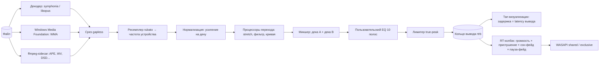

# 04. Аудиодвижок, автомикс и аудио-анализ

> Версия 1.3 · 2026-10-16 · статус: утверждено к реализации. Основание — `01a` §A, §B, §C, `01b` F-01…F-04, F-15, F-16, F-20, F-21 и `01c` (сон, фокус, звонки). Генератор «Моей волны» перенесён в движок волны — `14_WAVE_ENGINE.md`.
> Принцип: **копируем рабочую механику референсов, адаптируем под лицензии и офлайн-модель** (`10_DECISIONS.md`). Всё, что не подтверждено первоисточником, помечено 🧪 и закрывается спайком.

---

## 1. Конвейер (копия подхода VLC / MPD / Winamp / GStreamer)



- **Две «деки»** (A — играет, B — подготовлена следующая): так и в DJ-приложениях (Mixxx/djay: Auto DJ управляет двумя деками) и в движках с gapless (предоткрытие следующего трека — LUMEN/GStreamer/MPD).
- **Два этапа:** тяжёлая обработка (декодирование, ресемплинг, DSP, микс) — в потоке движка с запасом ~200 мс в кольце; в RT-колбэке — только копирование кадров и **«поздние» множители** (громкость, приглушение, фейд паузы), чтобы ползунок громкости реагировал мгновенно, а не через буфер.
- **Часы:** позиция UI = `segment.track_time + (кадры, отданные устройству − segment.ring_start)/rate − latency`; таблица сегментов пишется потоком движка; это даёт точные события «трек сменился» и позицию без дрейфа.
- Правила RT (см. `03` §3.1): никаких аллокаций/мьютексов/логов/IO в колбэке; метрики — атомики; `catch_unwind` вокруг декодеров.

### 1.1. Программный интерфейс движка (`sirtone-audio`)

```rust
pub trait AudioSink: Send {                       // как «output plugin» у MPD/Winamp
    fn devices(&self) -> Vec<DeviceInfo>;
    fn open(&mut self, req: SinkRequest) -> Result<SinkInfo>;   // фактическая частота/формат/latency
    fn start(&mut self) -> Result<()>;  fn stop(&mut self);
    fn on_device_event(&mut self, cb: Box<dyn Fn(DeviceEvent) + Send>);   // смена/потеря устройства
}
pub enum EngineCmd { Load{deck:Deck, track:TrackRef, start_ms:u64, autoplay:bool}, Play, Pause, Seek(u64),
    SetVolume(f32), SetMute(bool), SetEq(EqConfig), SetNorm(NormConfig), SetAutomix(AutomixConfig),
    SetDuck(DuckConfig), MixNow, PlaySfx(SfxId), SetOutput{device:Option<DeviceId>, exclusive:bool},
    SetSleepGain{target_db:f32, ramp_ms:u32},     // сон-таймер (14 §14): поздний множитель, линейно в dB
    SetWarmFilter{cutoff_hz:Option<f32>},          // «тёплый звук» при засыпании (None = выкл.)
    Shutdown }
pub enum EngineEvent { Position{ms:u64}, TrackStarted{track:TrackRef}, TrackEnded{track:TrackRef, reason:EndReason},
    TransitionPlanned(Plan), Underrun{count:u32}, DeviceChanged(DeviceInfo), SignalPath(SignalPath), Error(AppError) }
```

Движок запускается **без UI** (CLI-харнесс): `sirtone-cli play file`, `render --out wav` (оффлайн-рендер в WAV для тестов, детерминированный).

---

## 2. Форматы и декодеры

| Расширения | Контейнер/кодек | Декодер | Теги | Примечания |
|---|---|---|---|---|
| mp3 | MPEG-1/2 L3 | `symphonia` (bundle-mp3) | `lofty` ID3v1/v2, APE | gapless: LAME/Xing/VBRI |
| flac | FLAC | `symphonia` | `lofty` Vorbis comments | |
| wav, wave | PCM/float | `symphonia` | `lofty` RIFF INFO/ID3 | |
| aac, adts | AAC-LC (HE-AAC — флаги `he-aac`) | `symphonia` (флаг `aac`, не по умолчанию) | `lofty` | **gapless в symphonia нет** |
| m4a, mp4, m4b | AAC / ALAC | `symphonia` (флаги `isomp4`, `aac`, `alac`) | `lofty` MP4 ilst | **demuxer ISO/MP4 без gapless** → свою срезку по `iTunSMPB`/`elst` делаем сами |
| ogg, oga | Vorbis | `symphonia` | `lofty` | |
| opus | Opus | нативный `symphonia-codec-opus` (в README без оценки качества) **или** `libopus` через `symphonia-adapter-libopus` 0.3 — выбор S-02 | `lofty` | pre-skip; R128-теги |
| wv | WavPack | нативный `symphonia-codec-wavpack` (без оценки) → при проблемах sidecar | `lofty` | |
| aiff, aif | PCM | `symphonia` | `lofty` | |
| wma | ASF | **Windows Media Foundation** (`IMFSourceReader`) | WMF/Property System (lofty ASF не поддерживает) | преимущество Windows-only |
| caf, mka, webm | | `symphonia` | базовые | |
| ape, tta, mpc, dsf, dff | | **ffmpeg-sidecar** (опциональный пакет, докачивается с согласия) | `lofty` (APE, MPC) | DSD → PCM; пакет только LGPL-сборка |

Порядок выбора: **probe → symphonia → Media Foundation → ffmpeg-sidecar → «Не добавлено: формат не поддерживается»**. Матрица проверяется на корпусе фикстур (по одному файлу на кодек/контейнер/частоту/разрядность/каналы + «битые» файлы), спайк **S-02**.

**Факты из README Symphonia (проверено 2026-10-15, ветка main):** контейнеры AIFF (Great, gapless, флаг `aiff` — не по умолчанию), CAF (Good), ISO/MP4 (Great, **без gapless**, флаг `isomp4` — не по умолчанию), MKV/WebM (Good), OGG (Great, gapless), WAV (Excellent, gapless); кодеки AAC-LC (Great, **без gapless**, `aac` не по умолчанию), ALAC (Great), FLAC (Excellent), MP3 (Excellent, gapless, `mp3` не по умолчанию), PCM, Vorbis (Excellent), Opus и WavPack — есть, но без оценки статуса. ⇒ В `Cargo.toml` включаем флаги явно: `features = ["aac", "alac", "isomp4", "mp3", "aiff", "caf"]` (+ значения по умолчанию); gapless для M4A/AAC реализуем сами.

---

## 3. Ресемплинг, gapless, перемотка, паузы

- **Ресемплер:** `rubato` 5 (асинхронный sinc, высокое качество; аналог выбора сменного ресемплера в MPD: internal / libsamplerate / soxr). Целевая частота — **частота микс-формата устройства** (shared) или поддерживаемая устройством частота, ближайшая к файлу (exclusive). Один экземпляр на деку; `reset()` при перемотке.
- **Gapless** (`01b` F-01): срез задержки кодека в начале и паддинга в конце по LAME/Xing/VBRI (MP3), `iTunSMPB` и `elst` (M4A), pre-skip (Opus); **предоткрытие следующего трека** при остатке `< max(8 с, 2 × длина перехода)`, декодирование первых 2 с заранее; стык — по границе отсчёта, без пауз. Если у MP3 нет тегов — нет срезки (как у других плееров ○ S83) — это известное ограничение; детект тихих хвостов не используем в gapless-режиме.
- **Перемотка:** точная (`SeekMode::Accurate`), после неё сброс ресемплера/stretch; микро-кроссфейд 10 мс «хвост старой позиции → голова новой».
- **Пауза/старт/стоп:** линейная рампа 15 мс в RT-стадии.
- **Смена устройства:** `IMMNotificationClient` (в крейте `wasapi` — уведомления о добавлении/удалении устройств и смене default ✔) → переоткрытие `AudioSink` на текущей позиции; при потере (например, отключили Bluetooth-колонку) — **пауза** (тумблер), чтобы звук не прыгнул на динамики.

---

## 4. Автомикс и кроссфейд — спецификация (копия A из `01a`)

### 4.1. Режимы и настройки (как у Apple / Spotify / Rockbox)

| Настройка | Значения | По умолчанию |
|---|---|---|
| Режим переходов | `Без переходов (gapless)` · `Кроссфейд` · `Умный автомикс` | `Умный автомикс` ✅ (вкл) |
| Интенсивность (автомикс) | `Мягко` · `Умно` · `Как диджей` ✅ | `Умно` |
| Длина кроссфейда (режим `Кроссфейд`) | 1–12 с (Apple ✔, Spotify) | 6 с |
| Не микшировать альбомы по порядку | вкл/выкл | вкл ✅ |
| Не микшировать жанры | список (классика, live, ambient, аудиокниги) | по умолчанию заполнен |
| Ручной «Следующий» | короткий фейд 300 мс | вкл; команда «Смешать сейчас» |

### 4.2. Входные данные (из анализа, §10)

На трек: `duration`, `lead_silence_ms`, `tail_silence_ms` (порог **−60 dBFS**, как у Mixxx Skip Silence), `lufs_i`, `true_peak`, **огибающие громкости 10 Гц для первых и последних 30 с** (`env_head`, `env_tail`, u8 dB; как «10 выборок/с» Plexamp), `bpm`, `bpm_conf`, `beat_grid`, `grid_stability`, `key_camelot`, `key_conf`, `energy`, `genre_main`, `intro_vocal/outro_vocal` (🧪 C).

### 4.3. Планировщик перехода

Вызывается, когда известен следующий трек (до предоткрытия) и при смене настроек. Лестница отката копирует VirtualDJ («наивысший тип, приемлемый обоим») и Apple («простой кроссфейд вместо сложного, когда уместно»):

```
plan(A, B, ctx, cfg):
  0. Eligibility → GAPLESS (L0) если: режим=Gapless | (ctx.album_in_order(A,B) && cfg.skip_albums)
        | жанр A или B в чёрном списке | у любого нет базового анализа (тогда L1/ручной кроссфейд по режиму)
  1. L1  Срезка тишины + gapless (Mixxx Skip Silence): обрезать lead/tail silence, стык без перекрытия.
  2. L2  Перекрытие по огибающей (Plexamp/MPD/RadioBOSS):
        T_A = LUFS_A − 17 dB   (MPD: −17 dB; RadioBOSS: −14 dB)  # порог относительно громкости трека
        tail_A = время от последнего момента env_tail ≥ T_A до конца A (без тишины)
        head_B = время от начала B (после lead_silence) до первого момента env_head ≥ T_B
        overlap = clamp(tail_A + head_B, min_ov(интенс.), max_ov(интенс.))     # min: 0/2.5/4 с; max: 3/8/12 с
        режим затухания A:  если хвост A естественно затухает (env падает ≥ 6 dB за последние 4 с) → MIX (A не трогаем)
                            иначе → CROSSFADE equal-power (cos/sin)         # Rockbox: Mix vs Crossfade
        B входит: equal-power fade-in, если у B резкий старт; иначе без фейда
  3. L3  Beatmatch (VirtualDJ «tempo» / djay «Automatic»), при выполнении ВСЕХ условий:
        - bpm_conf(A) ≥ 0.8 и bpm_conf(B) ≥ 0.8, grid_stability ≥ 0.8 у обоих
        - r = bpm_B / bpm_A, приведённое к ближайшему из {1, 2, ½}; |r − 1| ≤ допуск(интенс.): 0 % / 6 % / 10 %
          (VirtualDJ: ±8/12/34 %; допуск 0 % у «Мягко» = L3 выключен)
        - тональности совместимы (Camelot: расстояние ≤ 1, A↔B) — иначе стиль Fade ≤ 4 с без EQ-swap
        Действие: «Sync + Tempo blend» (djay): ИСХОДЯЩИЙ A плавно подтягивается к темпу B (растяжение 1.0 → r),
        B играет в родном темпе; B стартует так, чтобы доля такта/бит совпала в конце перекрытия;
        длина = 8–32 битов (округление до такта) в [min_ov, max_ov]
  4. Стиль L3: «Fade» (equal-power) · «Blend» (EQ-swap: бас A убирается на второй половине, бас B возвращается;
        граница — по сильной доле) · «Filter» (high-pass A, развёртка 20→250 Гц)
        Автовыбор (по правилам, не random как у djay): electronic/dance/energy ≥ 0.7 → Blend; иначе Fade.
  → Plan { type: L0..L3, start_at_A, B_offset, overlap, curves, stretch_curve, eq_swap?, reason }
```

- **Ручной «Следующий»:** фейд-аут A 300 мс, B с фейд-ином 100 мс (foobar2000: fade на ручную смену; Rockbox: отдельное поведение для ручных).
- **«Смешать сейчас»** (djay *Mix Now*): ближайшая подходящая точка ≥ 1,5 с от текущей (при L3 — на границе такта), длина — `min(остаток, max_ov)`.
- **Минимум перекрытия** — 2,5 с у «Умно» (RadioBOSS), чтобы трек не «обрубало».
- **Exclusive/bit-perfect режим:** автомикс/кроссфейд недоступны (только gapless) — индикатор объясняет причину (как Spotify/Apple: «недоступно при Connect/AirPlay»).
- **Режимы движка волны** (`14` §14–15): засыпательная волна — `automix.mode = soft`: только L1/L2, `max_ov × 1,5`, L3 (beatmatch) выключен; фокус — на границе «работа → перерыв» принудительный кроссфейд 4 с, если трек не уложился в перерасход.
- **Бонус перехода в секвенсоре волны** (`14` §7) использует те же данные: темп в пределах ±8 % (с ×2/÷2) и Камелот ≤ 1 — бонус к оценке, не фильтр.

### 4.4. Исполнитель перехода

- Деки A и B читают из своих колец; микшер применяет к каждой деке: усиление нормализации → (A) `StretchProcessor` по кривой `s(t)` (Signalsmith Stretch, блоки по 512 кадров, число входных кадров на блок = `n_out · s`) → фильтр/EQ-swap (biquad) → кривая громкости; затем суммирование.
- **Задержка stretch** (≈ десятки мс) компенсируется предзапуском декодирования B; суммарная задержка перехода учитывается в `start_at_A`.
- Кривые: equal-power `gA = cos(πt/2)`, `gB = sin(πt/2)` (−3 dB в центре); MIX-режим: `gA = 1`.
- **Лимитер** после микса ловит суммарные пики.

### 4.5. Тесты автомикса (объективные)

| Тест | Метод | Порог |
|---|---|---|
| Фаза битов при L3 | клик-треки 90–174 BPM, измерить расхождение onset’ов в конце перекрытия | ≤ 20 мс |
| Уровень на стыке | RMS 400 мс до/после середины перекрытия | ≤ 1 dB |
| Нет щелчков | пик производной на стыке относительно соседей | не выше фона |
| Gapless | синус непрерывной фазы через стык | разрыв фазы = 0 отсчётов |
| Откат | подмена BPM-уверенности < 0,8 | план L2, не L3 |
| Альбом по порядку | очередь = альбом | план L0 |
| Субъективный A/B | 30 пар (электроника, рок, поп, классика) | оценка владельца |

---

## 5. Нормализация громкости (копия F-02)

- **Цель:** `Тихо −19 / Обычно −14 / Громко −11 LUFS` (трио Spotify ✔ ○); по умолчанию **−14**, как у Spotify Normal.
- **Усиление трека:** `g = clamp(target − LUFS_track, −12 dB, +6 dB)`; ограничение по пику: `g ≤ −1 dBTP − TP_track` (иначе — только в «Громко» допускается лимитер).
- **Учёт альбома** (Spotify/Tidal): если очередь = альбом по порядку — используется альбомная громкость (интегральная по всему альбому, хранится в `album`), чтобы сохранить динамику между треками.
- **Источники данных:** сначала **теги** (если есть): ReplayGain 2.0 (`REPLAYGAIN_TRACK_GAIN/ALBUM_GAIN`, эталон −18 LUFS: `LUFS = −18 − gain`), R128 для Opus (`R128_TRACK_GAIN`, Q7.8, эталон −23 LUFS) → мгновенно, до анализа; затем собственное измерение EBU R128 (`ebur128` crate, true-peak) — оно приоритетнее и записывается в БД. Теги в файлы **не пишутся**. Уточнения реализации — D-97 (R128 у Opus не читается, громкость альбома считается на лету, без лимитера ничего не поднимается вслепую).
- Выключено → усиление 0 dB (true-bypass); в exclusive/bit-perfect режиме выключается автоматически (с индикатором).

---

## 6. Эквалайзер (копия F-03)

- **10 полос графического EQ** (31,25 · 62,5 · 125 · 250 · 500 · 1k · 2k · 4k · 8k · 16k Гц), peaking-biquad (RBJ), Q ≈ 1,41, диапазон ±12 dB, **preamp** −12…+12 dB; авто-preamp от клиппинга `−max(0, max_gain)`; коэффициенты и состояние — `f64`, интерполяция коэффициентов 20 мс (без «зиппера»); true-bypass при выключении.
- Модель данных — **N полос** (можно расширить до 18, как AIMP/foobar2000).
- Пресеты (названия — по Apple Music/iOS): Flat, Bass Booster, Bass Reducer, Treble Booster, Treble Reducer, Vocal Booster, Loudness, Rock, Pop, Jazz, Classical, Electronic, Hip-Hop, Acoustic, Dance, Small Speakers, Spoken Word, Late Night; значения подбираются на слух (🧪 тюнинг на реальных колонках/наушниках) и хранятся в `assets/eq/presets.json`.
- Порядок в цепочке: **после** нормализации/микса, **до** лимитера ✅ («поверх чистого сигнала»).

---

## 7. Лимитер, громкость, приглушение, звуки интерфейса

- **Лимитер:** lookahead 1,5 мс, потолок −1 dBFS, release 50 мс; не вмешивается, пока сигнал ниже порога → цепочка остаётся бит-прозрачной, если EQ/нормализация/микс выключены.
- **Громкость:** кубическая шкала `g = (v/100)³` (−60 dB при 10 %), сглаживание 8 мс; **поздний множитель в RT-колбэке**.
- **Приглушение** (копия F-04: Android duck, Windows 80 %, Discord-ползунок):
  - Детект (поток платформы, COM MTA): `IAudioSessionManager2` — перечислить сессии на устройстве вывода; «чужая активная» = процесс не из дерева процессов Сиртона (включая `msedgewebview2.exe`), состояние Active, не `IsSystemSoundsSession`, пик `IAudioMeterInformation` > −60 dBFS непрерывно ≥ 700 мс.
  - Огибающая: attack 150 мс, hold 1 с после тишины, release 1,2 с; сила — ползунок 0–100 % (по умолчанию **75 % ≈ −12 dB**).
  - Исключения: настраиваемый список процессов; уведомления короче 700 мс не приглушают.
  - **Звонки (D-49):** для своей аудио-сессии вызываем `IAudioSessionControl2::SetDuckingPreference(TRUE)` (отказ от системного приглушения Windows на 80 % — иначе двойное с нашим); `IAudioSessionManager2::RegisterDuckNotification` сообщает об открытии/закрытии коммуникационного потока → обычное приглушение или **пауза** (опция «Пауза во время звонка»), возобновление через 2 с после закрытия, только если паузу ставили мы.
- **Сон-фейд** (`14` §14): `sleep_gain` — ещё один поздний множитель в RT-колбэке; цель (dB) и длительность рампы задаются атомарно из потока движка, в колбэке — интерполяция по блоку в линейной шкале dB → амплитуда; звуки интерфейса на время финала молчат. «Тёплый звук» — пологий ФНЧ (biquad, Q 0,707) в цепочке DSP перед лимитером, частота среза плавно 20 кГц → 6 кГц; включённый — индикатор тракта «DSP».
- **Звуки интерфейса:** короткие сэмплы, предварительно декодированные в частоту устройства, смешиваются в RT-стадии с отдельной громкостью (не создают аудио-сессий WebView); новые события — `focus_work_end`, `focus_break_end` (`06` §8).

---

## 8. Вывод на устройство (WASAPI)

| Режим | Реализация | Поведение |
|---|---|---|
| **Shared** (по умолчанию) | event-driven, буфер ≈ 20 мс, формат = микс-формат устройства; MMCSS «Pro Audio» | как у большинства плееров (Spotify и др. ◌) |
| **Exclusive** (опция) | event-driven, перебор форматов от родного к запасным (int32/24-в-32/int16/float); при занятом устройстве — откат в Shared | как MusicBee/MPD/VLC ✔; блокирует другие приложения → предупреждение; освобождение устройства после паузы N с |

- Библиотека вывода: **`wasapi` 0.26 (MIT)** — shared+exclusive, event-driven, уведомления об устройствах, перечисление аудио-сессий; запасной — `cpal` 0.18.2 (Apache-2.0, без exclusive). Выбор фиксирует спайк **S-01** (ADR D-05).
- **Индикатор тракта («Signal path»):** источник → декодер → ресемплер → DSP (EQ/норм/микс/лимитер) → устройство (+формат). «Bit-perfect» показывается, только если DSP выключен, частота совпала, громкость 100 % (или аппаратная).
- Underrun: заполнение тишиной, счётчик, событие; цель — 0 за 24 ч.

---

## 9. Тап визуализации

- Источник — **после лимитера, до поздних множителей**; задержка = `output_latency` (учтена в Rust, как `AudioGetSyncDelay` у Kodi и `timeStamp` у WMP/iTunes ✔).
- Кадр (≤ 60 Гц, `Channel` Tauri, сырые байты): заголовок 32 Б — `u8 version`, `u8 flags`, `u64 t_audio_ms`, `f32 beat_phase`, `f32 bpm`, `f32 bands[3]` (bass/mid/treb), + **`u8[1024]` mono, `u8[1024]` L, `u8[1024]` R** со смещением 128 (формат Butterchurn `timeByteArray*`: `u8 = clamp(128 + round(127·x))`) ≈ 3,1 КБ. FFT и биты вычисляет визуализатор (как у projectM/Kodi), `bands` и `beat_phase` — для шейдера «Волн».
- `beat_phase` берётся из **предрассчитанной сетки битов** (не из реактивного детектора) → «в такт» без задержки.

---

## 10. Анализ трека (фоновый конвейер)

### 10.1. Этапы

| Этап | Что считает | Как | Бюджет на 4-мин трек |
|---|---|---|---|
| **B0 (быстрый)** | длительность, тишина в начале/конце (−60 dBFS), **громкость EBU R128** (интегральная, true-peak, LRA), обзор пиков (400 точек u8), огибающие `env_head`/`env_tail` (10 Гц), **мягкость вступления и финала** (наклон огибающей первых 5 с / последних 10 с — для засыпательной волны, `14` §4.1) | полный декод в родной частоте, `ebur128` | ≤ 0,5 с CPU |
| **B1 (глубокий)** | темп/сетка битов, тональность (Camelot), спектральные признаки, MFCC, хрома | моно 22,05 кГц, STFT 2048/512; кандидат — `stratum-dsp` 1.0 (MIT/Apache; заявлено: BPM ±2 = 87,7 % на авторском наборе, ключ 72 %, ≈12 % октавных ошибок — **применять только при `conf ≥ 0.8`**) или собственная реализация (спайк S-08) | ≤ 0,6 с |
| **B2 (ML)** — 2.0: модель **поставляется в установщике**, работает без сети (D-84) | AudioSet-теггер (EfficientAT MobileNetV3 **MIT** или YAMNet Apache-2.0 → ONNX), 3 окна по 10 с (25/50/75 %), эмбеддинг → линейная проекция в 64 измерения (int8), вероятности жанров/«Singing»/«Speech»/«Music mood»; для волны сохраняются классы **Christmas music, Lullaby, Wedding music, Dance music, Background music, Happy/Sad/Tender/Exciting/Angry/Scary music** (проверено по карте классов YAMNet, `01c` §12) | `tract-onnx` (чистый Rust) либо `ort`; спайк S-07 | ≤ 0,8 с |
| **B3 (производные)** | `valence, arousal, aggression, energy, danceability, acousticness, vocal`, настроения (+ «нежное», «мрачное», «праздничное» для тонов событий), занятия, язык; **вектор признаков волны** `track_features` (32 числа, `14` §4.1) | правила + калибровка (§10.3) | ~0 |

Итого цель: **≤ 2 с CPU на трек**; 10 000 треков ≈ 5,5 ч на 1 ядре, ≈ 1 ч на 6 ядрах (как у Plex: «часы или дни», но в фоне, с прогрессом).

### 10.2. Схема признаков (копия Spotify audio features + Яндекс)

Числа в [0, 1] (как у Spotify ✔): `valence` (позитивность), `energy`, `danceability`, `acousticness`, `vocal` (≈ 1 − `instrumentalness`), `aggression` (расширение), `arousal` (расширение); плюс `bpm`, `key`, `mode`, `lufs`. **Язык** — `ru / foreign / none / unknown`: метаданные (тег TLAN, MB work language онлайн, письменность артиста/названия) → затем аудио (`vocal` низкий → `none`); опционально (флаг) LID по вокалу (Whisper-tiny/VoxLingua) — C. Смешанный → преобладающий ✅.

**Настроения** (ТЗ) — мягкие области на плоскости (valence, arousal), прототипы в `assets/vibe/moods.json`:

| Настроение | Прототип (v, a) | Примечание |
|---|---|---|
| весёлое | (0,80; 0,70) | |
| бодрое | (0,65; 0,85) | |
| спокойное | (0,60; 0,20) | |
| грустное | (0,20; 0,25) | |
| агрессивное (характер) | (0,20; 0,85) + `aggression` | |
| позитивное | `v ≥ 0,62` | гистерезис |
| негативное | `v ≤ 0,38` | гистерезис |

Принадлежность = softmax по расстоянию до прототипов (σ = 0,22); признак присваивается при `membership ≥ 0,45` и отрыве от второго ≥ 0,15, иначе «не определено» (трек остаётся в библиотеке, в фильтр не попадает).

**Занятия** (названия — как в «Моей волне» и ТЗ): трапециевидные функции принадлежности по (`bpm`, `energy`, `arousal`, `vocal`, `acousticness`, `LRA`) в `assets/vibe/activities.json`: *тренировка* (темп 120–180, energy ≥ 0,6), *сон* (темп ≤ 90, energy ≤ 0,3, vocal ≤ 0,5), *работа/фокус* (arousal 0,25–0,6, vocal ≤ 0,35), *дорога* (темп 90–140, valence ≥ 0,45), *отдых*, *вечеринка* (danceability ≥ 0,65, energy ≥ 0,7). Это эвристики — калибруются на золотом наборе.

### 10.3. Модели, лицензии, калибровка

| Решение | Выбор |
|---|---|
| Базовая модель (по умолчанию) | **Только допустимые лицензии:** EfficientAT (MIT) / YAMNet (Apache-2.0) / PANNs (MIT). **Essentia-модели (CC BY-NC-SA/ND) не включаем** (`08` §3); возможна подгрузка пользователем из своей папки `models/` — решение владельца ❓ |
| Инференс | `tract-onnx` 0.23 (MIT/Apache, чистый Rust) — основной; `ort` 2.0-rc — опция с DirectML |
| Калибровка | **Золотой набор** ≈ 200–300 треков библиотеки владельца с ручной разметкой на плоскости valence–arousal (встроенный инструмент «Калибровка», он же — интерфейс правок); метрики: MAE по V/A, F1 по настроениям, «воздержание» при низкой уверенности |
| Прокси-метрика сходства | retrieval@10 «тот же исполнитель среди ближайших» (без ручной разметки) |
| Обучение на правках | логистическая «голова» поверх [эмбеддинг + DSP] учитывает правки пользователя; приор «по соседям»: `posterior ∝ P(audio) · Prior(artist/folder)`, где сила приора ~ log(1 + число размеченных треков исполнителя) |

### 10.4. Хранение и версии

Результаты пишутся в `track` (см. `03` §7) + `analysis_version`; при смене версии алгоритма трек ставится в очередь переанализа (приоритет низкий). Кэш — как у bliss (повторно не анализируем неизменённые файлы: ключ `content_hash + analysis_version`).

---

## 11. Сходство, шафл, продолжение плейлиста

- **Вектор трека** `v` = [эмбеддинг(64, int8→f32, L2-норма) | темп (sin/cos по log2(bpm), 2) | тональность (круг квинт, 2) | MFCC μ (13) | valence/arousal/energy (3)], веса блоков 1.0 / 0.3 / 0.3 / 0.5 / 0.5. Сходство — косинус; ближайшие — **полный перебор** (10⁵ × ~84 float — миллисекунды) без ANN-индексов.
- **Гибридное продолжение** (Roon/Plexamp/Spotify Smart Shuffle, `01b` F-14): центроид `c` плейлиста (с весами позиций); кандидаты — вся библиотека минус плейлист минус недавно игравшие; `score = cos(v, c)·1.0 + continuity(prev→t)·0.3 + novelty·0.1`; диверсификация **MMR** (λ = 0,7, штраф за повтор исполнителя); **порог остановки** `θ = clamp(μ_pl − 1.0·σ_pl, 0.55, 0.85)` (μ, σ — по попарному косинусу внутри плейлиста); нет кандидатов выше θ → воспроизведение останавливается ✅. «−» на рекомендованном — исключение трека из будущих продолжений этого плейлиста.
- **Шафл** (Spotify «Fewer Repeats», iTunes Smart Shuffle): K = 8 перестановок Фишера–Йейтса → оценка `S = −Σ w(i)·freshness_penalty(track_i) − λ_a·(# подряд одинаковых исполнителей) − λ_b·(# подряд одинаковых альбомов)`, `w(i) = 1/(1 + i/10)`, `freshness_penalty = 1/(1 + дней с last_played)`; берём лучшую. Ручного ползунка «вероятность того же исполнителя» нет (C).
- **Продолжение «Моей волны»** — ~~взвешенная выборка с «блужданием» по вайбу~~ **заменено движком волны** (`14`, D-38): скоринг всех компонентов профиля → квоты новизны → Томпсон → секвенсор (исполнитель ≤ 1 на 5, повтор ≥ 24 ч, |Δenergy| ≤ 0,35, бонус перехода, выборка из топ-20 с температурой).

---

## 12. Бюджеты и тесты движка

| Показатель | Цель |
|---|---|
| Клик → первый звук (прогретый декодер / холодный) | ≤ 60 мс / ≤ 150 мс |
| CPU воспроизведения (без визуализации, 44,1 кГц FLAC) | < 2 % ядра Ryzen 7 5800H |
| Underrun за 24 ч на «железе владельца» | 0 |
| Задержка команд пауза/громкость → звук | ≤ 30 мс / ≤ 15 мс |
| Анализ | ≤ 2 с CPU на трек; не вызывает underrun; пауза при батарее/игре |
| Дрейф позиции за 1 ч | ≤ 20 мс |

**Тесты:** юнит (кривые, EQ-отклик по sweep, нормализация ±0,1 dB, true-peak, ресемплер THD+N), property-тесты (seek/pause последовательности), оффлайн-рендер с побайтовым сравнением («золотые» WAV), корпус форматов, soak 24 ч (случайные seek/смена устройства/автомикс), метрики автомикса §4.5, золотой набор анализа §10.3.
