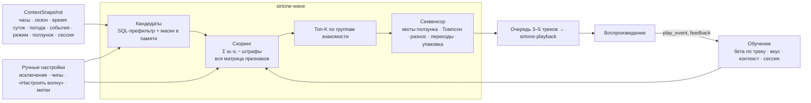
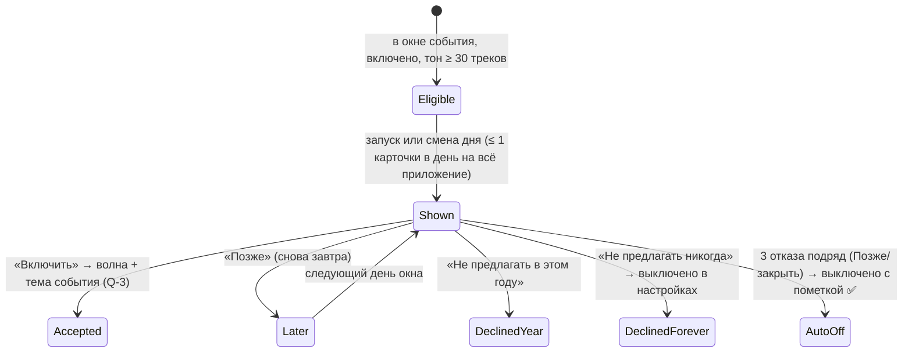

# 14. Движок волны: технический дизайн (дополнение §25–38)

> Версия 1.4 · 2026-10-16 · статус: **утверждено к реализации**; решения по вопросам Q-1…Q-17 приняты владельцем 2026-10-16 (`10` §5).
> Основание: дополнение владельца `docs/source/Сиртон_ТЗ_дополнение_волна_2026-10-16.md` (утверждено: фичи и поведение; предложение: архитектура и числа), референсы `01c` (W-01…W-11), прототип `spikes/S-17-wave-scoring` + отчёт `docs/reports/spike-S-17.md`.
> Обозначения: ✅ утверждено владельцем · ✅Q-n — предложение, принятое владельцем по вопросу Q-n (`10` §5) · 🔧 решение проектировщика (меняется ADR) · 🧪 закрывается спайком.

---

## 0. Что это и чем отличается от исходного плана

Девять фич дополнения — **профили одного движка**, а не девять систем ✅. Новая волна = новый JSON-профиль, без нового кода ✅. Движок заменяет генератор «Моей волны» из `04` §11 (последний пункт) и `05` §10.1 — фильтры «Настроить волну» становятся слоем 3 движка, а не отдельным алгоритмом.

| Фича | Профиль/модуль | Этап | Требования |
|---|---|---|---|
| A — самонастройка и ручная настройка | `learn`, `explain`, чипы, «Мои волны» | 1 (данные), 3, 5 | FR-WENG, FR-LEARN |
| B — сезонная волна | профиль `seasonal`, модуль `season` | 1 (календарь), 3 | FR-SEAS |
| C — волны под события | профиль `event`, модуль `events` | 1 (календарь), 5 | FR-EVT |
| D — сезонные темы | `theme` (Rust) + генератор акцента (UI) | 4 | FR-THEME |
| E — живые эффекты | `features/fx` (WebGL2) + `weather` | 4 (по сезону), 5 (погода) | FR-FX |
| F — сон | профиль `sleep`, `timers::sleep`, фейд в движке | 4 | FR-SLEEP |
| G — фокус | профиль `focus`, `timers::focus` | 4 | FR-FOCUS |
| H — ползунок новизны | квоты секвенсора + компонент `novelty` | 3 | FR-NOV |
| I — «Для всех» | профиль `for_all`, модель гостей, популярность | 3 | FR-ALL |

---

## 1. Конвейер (копия двухступенчатой схемы YouTube + бандитов Spotify/Deezer, `01c` W-03)



**Приоритет слоёв** ✅: ручное > режим > событие > сезон > обучение.

1. Ручные исключения и «никогда в волне» — всегда (маска).
2. Жёсткие фильтры режима (сон — без агрессивного; «Для всех» — без мрачного).
3. Фильтры «Настроить волну» (жёсткие: язык, частота; мягкие: настроение, характер, занятие, обстановка — `05` §10.1).
4. Мягкие веса профиля.
5. Меньше 30 кандидатов после фильтров → ослабление по `relax_order` профиля + пометка «расширили подборку» ✅. Слои 1–2 не ослабляются никогда 🔧.

---

## 2. Размещение в архитектуре

### 2.1. Крейт `sirtone-wave` 🔧 (новый доменный крейт)

Зависит **только от `sirtone-core`** (правило `03` §3.1). Модули:

| Модуль | Ответственность |
|---|---|
| `clock` | трейт `Clock` (системные/фиксированные/ускоренные часы) |
| `calendar` | григорианские даты, Пасха (зап./прав.), Масленица, равноденствия/солнцестояния, «N-й день недели» (код прототипа S-17) |
| `context` | сборка `ContextSnapshot`, время суток (восход/закат — крейт `sunrise`, без сети), классы погоды, устаревание |
| `features` | `FeatureMatrix` — вектор 32×f32 на трек в памяти, атомарная замена (`arc-swap`) при изменении библиотеки |
| `profile` | схема `WaveProfile` (JSON, версия), загрузка встроенных и пользовательских, валидация, наложение слоёв |
| `scoring` | трейт `Component`, компоненты §6, штрафы, ослабление |
| `sequencer` | квоты, Томпсон, ограничения, выборка, упаковка в сегменты |
| `learn` | модели §8, политики обучения, холодный старт, заморозка/сброс |
| `season` | веса сезонов, аффинность трека к сезону (4 источника) |
| `events` | календарь событий (JSON), правила дат, оценка трека, автопредложения |
| `theme` | выбор активной темы (сезон/событие/ручная) → исходный цвет и палитра визуализации |
| `timers` | планы сна и фокуса (кривые, сегменты, состояния) — без доступа к звуку |
| `explain` | «Почему этот трек», состав волны (чипы) |
| `universal` | оценка «для всех», атмосферы, модель гостей |

Связи с соседями — только через трейты `core`, сборка — в `sirtone-app`:

| Нужно движку | Трейт в `core` | Реализует |
|---|---|---|
| треки, признаки, статистика, запись событий | `WaveRepo` (чтение срезов, запись `play_event`/`feedback`/моделей батчами) | `sirtone-library` |
| следующая порция очереди | `QueueSource { fn next_batch(&mut self, n) -> Vec<TrackId>; fn on_track_end(&mut self, PlayOutcome) }` | `sirtone-wave` (для playback) |
| фейд сна, мягкий автомикс, нормализация на время фокуса | `PlaybackControl` (команды) | `sirtone-playback` |
| погода, популярность | данные приходят готовыми из задач `refresh_weather`/`refresh_popularity` (`sirtone-net` → `app` → `wave`) | `sirtone-app` |
| сон ПК/экран, ввод пользователя, звонки | `PowerActions`, `UserActivity`, `CallSignal` | `sirtone-platform` |

### 2.2. Потоки

Движок живёт в **отдельном потоке `wave-worker`** (normal priority) с очередью команд (`crossbeam-channel`): события воспроизведения, обратная связь, смена контекста/настроек, запросы UI. Пересборка очереди (≈ 3 мс на 50 000 треков, §20) не блокирует ни UI, ни движок звука. Обновление моделей — там же, запись в БД — батчами через DB writer (`03` §4).

---

## 3. Часы и контекст

### 3.1. Подменяемые часы ✅

```rust
pub trait Clock: Send + Sync {
    fn now_utc_ms(&self) -> i64;
    fn local_offset_min(&self, utc_ms: i64) -> i32;   // часовой пояс Windows на этот момент
}
// SystemClock — по умолчанию; FixedClock(ts) — тесты; AcceleratedClock{start, speed} — отладка AT-24:
// `sirtone-cli wave simulate --from 2027-01-01 --to 2030-12-31 --step 6h` и скрытая отладочная настройка.
```

Всё, что зависит от даты (сезон, события, время суток, окно повтора, затухание бета-моделей), берёт время только из `Clock`.

### 3.2. `ContextSnapshot` (собирается перед каждой пересборкой очереди)

| Поле | Источник | Без сети/данных |
|---|---|---|
| `now`, `local_minute`, `weekday` | `Clock` | всегда есть |
| `daypart` (рассвет, утро, день, вечер, закат, ночь) | солнце по координатам (`05` §10.2) | по часам |
| `season_w: [f32;4]` (+ фаза перехода) | §10.1 | всегда есть |
| `hemisphere` | широта выбранного города; без города — северное 🔧 | северное |
| `weather: Option<WeatherState>` | `weather_cache`, класс + интенсивность + ветер + `is_day` + `fetched_at` | `None`, если нет или старше 3 ч ✅ |
| `events: Vec<(EventId, intensity 0..1)>` | §11 | всегда (офлайн-календарь) |
| `mode`, `profile_id` | выбранная волна | — |
| `filters` | «Настроить волну» + чипы | — |
| `novelty: 0..1` | ползунок или фиксированное значение режима | — |
| `session` | последние действия в сессии (§8.5) | — |

### 3.3. Классы погоды (из кодов WMO Open-Meteo, `01c` §12)

`clear` (0–1) · `cloudy` (2–3) · `fog` (45, 48) · `drizzle_rain` (51–67, 80–82) · `snow` (71–77, 85–86) · `storm` (95–99). Интенсивность: осадки `precipitation`/`snowfall` за 15 мин, нормированные; ветер `wind_speed_10m`, `wind_direction_10m` → вектор сноса частиц; `temperature_2m` — для «Первого тёплого дня».

---

## 4. Признаки трека

### 4.1. Вектор (32 × f32, все в [0, 1]) 🔧 — расширение схемы `04` §10.2

| № | Признак | Источник (`04` §10) |
|---|---|---|
| 0 | energy | B3 |
| 1 | valence | B3 |
| 2 | arousal | B3 |
| 3 | danceability | B3 |
| 4 | tempo = (clamp(bpm, 50, 200) − 50) / 150 | B1 |
| 5–6 | тональность на круге квинт: 0,5 + 0,5·sin/cos | B1 |
| 7 | лад (мажор 1 / минор 0 / неизв. 0,5) | B1 |
| 8 | acousticness | B3 |
| 9 | vocal (доля вокала ≈ 1 − instrumentalness) | B2/B3 |
| 10 | яркость спектра (центроид, норм.) | B1 |
| 11 | динамика (LRA / 20 LU) | B0 |
| 12 | громкость ((LUFS + 30) / 25) | B0 |
| 13 | длительность (log, норм.) | теги |
| 14 | год ((год − 1950) / 80) | теги/MB |
| 15 | aggression | B3 |
| 16 | мягкость вступления (наклон `env_head` первых 5 с) 🔧 | B0 |
| 17 | мягкость финала (наклон `env_tail` последних 10 с) 🔧 | B0 |
| 18–25 | теги настроения: весёлое, бодрое, спокойное, грустное, агрессивное, нежное, мрачное, праздничное | B2 (AudioSet: Happy/Exciting/Tender/Sad/Angry/Scary/**Christmas** music) + B3 |
| 26–31 | жанровые группы: поп/танцевальное · рок/метал · электроника · хип-хоп/R&B · классика/джаз/эмбиент · фолк/прочее | теги → MB genres → модель |

Не входят в вектор, а хранятся колонками для SQL-префильтра: язык, `explicit`, «никогда», ручные метки, длительность в мс. Трек без глубокого анализа получает **средние по медиатеке** и `conf < 1`; такие треки участвуют, но с понижающим множителем `0,8 + 0,2·conf` 🔧 (волна работает с первого дня, `01c` W-03 «холодный старт»).

### 4.2. Хранение и память

`track_features.vec` (BLOB f32[32]) → при старте и после `library://changed` — в `FeatureMatrix` (row-major `[f32; 32]` на трек). 50 000 треков = 6,4 МБ ✅, все массивы движка ≈ 8,8 МБ (замер S-17).

---

## 5. Профиль волны (`WaveProfile`)

### 5.1. Схема (JSON, `"schema": "sirtone.wave-profile/1"`)

```jsonc
{
  "schema": "sirtone.wave-profile/1",
  "id": "sleep",                       // встроенные: my_wave, seasonal, event, sleep, focus, for_all; свои: user:<uuid>
  "name_key": "wave.profile.sleep",    // встроенные — ключ i18n; свои — "name": "Ночная зимняя"
  "hard_filters": {                    // слой 2 (никогда не ослабляется)
    "max_aggression": 0.35, "max_energy_over_curve": 0.25,
    "exclude_moods": ["aggressive"], "language": null, "explicit": "allow"
  },
  "weights": { "taste": 0.25, "session": 0.025, "context": 0.05, "season": 0.05,
               "event": 0.0, "curve": 0.60, "novelty": 0.0, "universal": 0.0, "filters": 0.025 },
  "target_curve": { "kind": "sleep", "min_energy": 0.1, "shape": 1.6 },   // null = ровная волна
  "novelty": { "mode": "clamp", "max": 0.25 },                          // "slider" | "clamp" | "fixed" | "ignore"
  "learning_policy": "context_only",                                    // full | context_only | none | separate_model
  "sequencing": { "artist_spacing": 5, "repeat_window_h": 24, "max_energy_jump": 0.35,
                  "transition_bonus": true, "segment_packing": "timer" },
  "relax_order": ["filters.atmosphere", "filters.activity", "filters.character", "filters.mood", "curve.width"],
  "visual": { "viz_tempo": 0.4, "viz_dim": 0.5, "viz_warm": 0.6, "theme": null, "effect": null },
  "automix": { "mode": "soft" }                                        // soft = L2 с длинными перекрытиями, без L3
}
```

Встроенные профили — `assets/wave/profiles/*.json` (в бинарнике); пользовательские («Мои волны») и переопределения встроенных — таблица `wave_profile` (§18). Сохранение «Моей волны» с текущими чипами/фильтрами/ползунком — снимок в свой профиль (YouTube Music: «сохранить своё радио», `01c` W-02).

### 5.2. Стартовые веса (таблица владельца; остаток делят `session` и `filters` поровну) ✅/🔧

| Профиль | taste | context | season | event | curve | universal | session | filters |
|---|---|---|---|---|---|---|---|---|
| Моя волна | 0,45 | 0,15 | 0,10 | 0,10 (только в окне события, иначе → taste) | — | — | 0,10 | 0,10 |
| Сезонная | 0,30 | 0,10 | 0,45 | 0,05 | — | — | 0,05 | 0,05 |
| Событие | 0,25 | 0,05 | 0,10 | 0,55 | — | — | 0,025 | 0,025 |
| Сон | 0,25 | 0,05 | 0,05 | — | 0,60 | — | 0,025 | 0,025 |
| Фокус | 0,30 | — | 0,05 | — | 0,50 | — | 0,075 | 0,075 |
| Для всех | 0,05 | 0,10 | 0,05 | 0,05 | — | 0,75 | — | — |

Ползунок новизны (§9) действует не весом, а квотами секвенсора и множителем исследования; поэтому в таблице его нет. Калибровка весов — на прототипе и золотом наборе (`OWN-08`); чипы «Состав волны» и «сила влияния» в «Настроить волну» умножают веса сезона/контекста/событий на 0…2 с последующей нормировкой.

---

## 6. Скоринг

```text
score(t) = Σᵢ wᵢ · sᵢ(t, ctx)  +  ε · explore(t)  −  penalty(t)        (все sᵢ ∈ [0, 1])
```

```rust
pub trait Component: Send + Sync {
    fn id(&self) -> ComponentId;
    /// Подготовка на пересборку (O(1)…O(D)): сэмпл весов, кэш контекста.
    fn prepare(&mut self, ctx: &ContextSnapshot, models: &Models);
    /// Горячий путь: без аллокаций, O(D).
    fn score(&self, t: TrackIdx, x: &[f32; 32], ctx: &ContextSnapshot) -> f32;
    /// Короткая причина для «Почему этот трек» (только для выбранного трека).
    fn explain(&self, t: TrackIdx, x: &[f32; 32], ctx: &ContextSnapshot) -> Option<Reason>;
}
```

| Компонент | sᵢ (кратко) | Раздел |
|---|---|---|
| `taste` | 0,6·σ(w̃·x + b) + 0,4·α/(α+β); w̃ — сэмпл Томпсона на пересборку | §8 |
| `session` | 0,5 + 0,5·tanh(sₛ·x), sₛ — вектор сессии с затуханием | §8.5 |
| `context` | σ(w_ctx·x), w_ctx — веса контекста после отката «узкий → широкий» | §8.3 |
| `season` | Σₛ w_ctx(s) · aff(t, s) | §10 |
| `event` | max(прямое совпадение, 0,5·совпадение по тону) для активного события | §11 |
| `curve` | 1 − min(1, |energy − E(t)| / ширина) | §14, §15 |
| `novelty` | для группы «новое/нетронутое»: 0,15·ν·‖x − центр вкуса‖ | §9 |
| `universal` | оценка «для всех» | §16 |
| `filters` | произведение функций принадлежности мягких фильтров «Настроить волну» (`05` §10.1) | — |

**Штрафы:** недавно звучал (жёстко — окно повтора 24 ч ✅, мягко — `1/(1 + дней)` ещё 7 дней 🔧); исполнитель рядом (жёстко — секвенсор); плохой переход для автомикса (только бонус за хороший, §7) ✅; «не сейчас» в текущем контекстном ведре (жёстко на 7 дней 🔧).

**Ослабление** (< 30 кандидатов со `score ≥ 0,5` после слоёв 1–3) — по `relax_order` профиля, шагами, до появления 30; UI получает `relaxed: [шаги]` → пометка «расширили подборку» ✅.

---

## 7. Секвенсор

| Правило | Значение | Основание |
|---|---|---|
| Выбор группы знакомости | наибольшее отставание от квоты ползунка (`quota_g·(n+1) − count_g`) | Smart Shuffle «1 из 3», прототип S-17 |
| Исследование | внутри группы: `score + ε·(Beta(α,β) − α/(α+β))`, ε = 0,10 + 0,30·ν | Томпсон (Chapelle & Li, Deezer) |
| Не всегда лучший | softmax по топ-20 с температурой T = 0,05 ✅ | дополнение §26 |
| Горизонт | 3–5 треков вперёд ✅; пересборка при смене контекста (время суток, класс погоды, событие, день), после действия пользователя, когда в очереди < 3 | ✅ |
| Исполнитель | не чаще 1 раза на 5 треков ✅ (жёстко; при нехватке — ослабление до 3) | ✅ |
| Повтор трека | не раньше 24 ч ✅ (настройка 0–168 ч) | ✅ |
| Плавность энергии | |Δenergy| ≤ 0,35 🔧, кроме перехода «работа → перерыв» в фокусе ✅ и явного «энергичное» | ✅ |
| Переход для автомикса | +0,02 за темп в ±8 % (с учётом ×2/÷2) и +0,02 за Камелот ≤ 1 — бонус, не фильтр ✅ | `04` §4.3 |
| Упаковка в сегмент | сон/фокус: §7.1 | ✅ |

### 7.1. Упаковка в сегмент (сон, фокус)

Остаток сегмента `R`. Кандидат хорош, если после него `R − dur ≥ 150 с` (поместится ещё трек) или `R − dur ∈ [−overrun, 30 с]` (закончит у границы). Выбор: сначала по `score`, среди равных ±0,02 — по близости к границе. Не помещается ничего → самый короткий подходящий и на границе **переход** (фокус: кроссфейд 4 с в перерыв; сон: финальный фейд §14). `overrun` по умолчанию 90 с ✅.

---

## 8. Обучение (фича A)

### 8.1. Сигналы → обновления 🔧 (сила из таблицы владельца ✅ → числа)

| Действие | y | вес | Модели |
|---|---|---|---|
| Лайк | 1 | 1,0 | бета трека, вкус, контекст; **везде, в любом режиме** |
| «Никогда в волне» | — | — | жёсткое исключение (трек или исполнитель) + y = 0, вес 0,5 во вкус |
| Пропуск в первые 30 с | 0 | 0,8 | бета, вкус, контекст |
| Пропуск от 30 с до середины 🔧 | 0 | 0,3 | то же |
| Пропуск после середины | 0 | 0,1 | то же |
| Повтор трека | 1 | 0,5 | бета, вкус |
| Добавил в плейлист | 1 | 0,5 | бета, вкус |
| Включил вручную из поиска/коллекции | 1 | 0,5 | бета, вкус, контекст |
| «Не сейчас» | 0 | 0,5 | **только контекстная модель** + полка на 7 дней в этом контекстном ведре |
| Дослушал | 1 | 0,2 (0,4 для «нового для тебя» — «усиленный плюс» ✅) | бета, вкус, контекст |
| Пауза, сон-таймер, закрытие | — | — | не сигнал ✅ |

Всё событие пишется в `play_event` со снимком контекста ✅ (с Этапа 1, §18).

### 8.2. Модели (решение: Томпсон + бета + байесовская логистическая регрессия; обоснование — `01c` W-03)

| Модель | Формула | Обновление |
|---|---|---|
| Отношение к треку | Beta(α, β), приор α₀ = β₀ = 1; затухание к приору с полураспадом 90 дней ✅: `α ← 1 + (α − 1)·2^(−Δд/90)` | `α += w` при y = 1, `β += w` при y = 0 |
| Вкус в пространстве признаков | логистическая регрессия, постериор N(m, diag(1/q)) | `p = σ(m·x + b)`; `qᵢ += w·p(1−p)·xᵢ²`; `mᵢ += w·(y − p)·xᵢ / qᵢ` — 35 нс (S-17) |
| Контекст | те же векторы на уровнях: общий → время суток (6) → время суток × сезон (24) → × класс погоды (144) | эффективные веса = Σ λₗ·wₗ, `λₗ = nₗ/(nₗ + 20)` — откат «зима + вечер + дождь → вечер → общий вкус» ✅ |
| Сессия | вектор sₛ, полураспад 10 мин (эффект ≈ 20 мин ✅) | пропуск: `sₛ −= 0,15·(x − c)`; лайк: `+= 0,10·(x − c)`; 3 пропуска подряд с похожим настроением (косинус тегов ≥ 0,8) → ×2; 2 лайка подряд энергичного → +0,2 по оси энергии ✅ |
| Фокус | отдельная бета `focus` по трекам | пропуски/дослушивания только в режиме фокуса ✅ |
| Гости («Для всех») | отдельная бета `guests` | все реакции в этом режиме ✅ |

**Томпсон:** веса вкуса сэмплируются один раз на пересборку (`m + σ·N(0,1)/√q`, σ = 0,3·(0,5 + ν)); бета — для топ-кандидатов в секвенсоре. Сила исследования растёт с ползунком (§9) ✅.

**Почему не LinUCB** (альтернатива из дополнения): нужна матрица d×d и её обращение на каждый контекст (O(d²) на событие), бонус UCB плохо переводится в понятное «почему», а Томпсон эмпирически не хуже (Chapelle & Li; Deezer) и естественно масштабируется ползунком. Замена возможна без смены интерфейсов (`Component`/`Models`).

### 8.3. Холодный старт ✅

Анкеты нет. Приоры: (1) звучание — центр вкуса = средневзвешенный вектор медиатеки, где вес трека ∝ `ln(1 + число треков исполнителя в медиатеке)` («много треков исполнителя — выше интерес»); (2) статистика прослушиваний, если уже есть (`play_count`, `completion_ema`, лайки) — однократная «прокрутка» в модели при первом запуске движка; (3) контекстные приоры `assets/vibe/context.json` (ночь — спокойнее и т.п.).

### 8.4. Политики обучения ✅

| Политика | Профили | Что обновляется |
|---|---|---|
| `full` | Моя волна, Сезонная, Событие, «Мои волны» | всё по §8.1 |
| `context_only` | Сон | только явные действия; пропуски — в контекст «сон»; лайк/«никогда» — глобально |
| `separate_model` | Фокус → модель `focus`; Для всех → модель `guests` | вкус владельца — только от лайка и «никогда» (фокус) / не меняется (для всех) |
| `none` | любой при выключенном тумблере «Учиться на прослушиваниях» ✅ | ничего (лайки и «никогда» сохраняются как факты, модели не трогаются) |

Сброс ✅: целиком или по контексту (уровни §8.2), с подтверждением; удаляет параметры моделей и бета-распределения выбранного ведра; журнал `play_event` — по отдельной галочке.

### 8.5. Короткая память сессии ✅

Живёт только в памяти, не пишется в модели. Сессия = до 30 мин без воспроизведения.

---

## 9. Ползунок «Знакомое ↔ Неожиданное» (фича H)

| Категория ✅ | Определение 🔧 |
|---|---|
| Любимое | лайк, или ≥ 8 прослушиваний и бета-среднее > 0,7 |
| Знакомое | ≥ 1 прослушивание (и не «забытое») |
| Забытое | ≥ 3 прослушиваний и последнее > 60 дней назад ✅ (Spotify Repeat Rewind: > 1 мес.) |
| Новое | добавлено ≤ 30 дней и < 2 прослушиваний |
| Нетронутое | в медиатеке > 30 дней, 0 прослушиваний |

Три эффекта ✅: (1) **квоты** групп «любимое+знакомое / забытое / новое+нетронутое» по таблице владельца с линейной интерполяцией между засечками (проверено S-17: 0 → 0,90/0,10/0; 50 → 0,50/0,20/0,30; 100 → 0,15/0,15/0,70); (2) **непохожесть** — компонент `novelty` тянет вправо дальше от центра вкуса; (3) **сила исследования** ε и σ (§7, §8.2). Экспертный режим ✅ — два ползунка: «неслушанность» (квоты) и «непохожесть» (вес `novelty` и σ).

Ограничители ✅: сон и фокус — не выше 25; «Для всех» — игнорирует; «никогда» и бета-среднее < 0,2 не возвращаются даже на 100; контекстные фильтры действуют всегда. Метка «новое для тебя» — у треков групп «новое/нетронутое» в очереди ✅.

**Связь с блоком «Частота» (`FR-WAVE-003`)** ✅Q-12: «Частота» — жёсткий фильтр слоя 3 (выбран → только эти группы), ползунок при этом неактивен с подсказкой «частота выбрана вручную» (ручное сильнее).

---

## 10. Сезоны (фича B)

### 10.1. Определение сезона

- Метеорологические сезоны ✅; южное полушарие — сдвиг на полгода ✅.
- **Переходное окно ±21 день** ✅Q-10 вместо ±10 из дополнения: пример владельца «20 ноября — осень 0,7, зима 0,3» и AT-14 «22 ноября акцент заметно ближе к зимнему» при окне ±10 не выполняются (20 ноября было бы чистой осенью). С окном 21 день: 20.11 → 0,76/0,24, 22.11 → 0,71/0,29 (тест прототипа). Значение в конфиге.
- Погода сдвигает веса не больше чем на 0,3 ✅ (снег в апреле → зима; > +25 °C в мае → лето; нормировка к 1).
- Ручной выбор сезона перекрывает всё ✅.

### 10.2. Сезонность трека — четыре источника ✅

```text
aff(t, s) = метка ? (1 | 0)
          : (w_звук·звук(t,s) + w_слова·слова(t,s) + w_история·история(t,s)) / Σw
w_история = 0,5 · min(1, дней_истории / 365)   ✅ («от 0 до ~0,5 после года»)
w_слова   = 0,3, если найдено слово сезона, иначе 0
w_звук    = 1 − w_история − w_слова
```

- **Звук:** профили сезонов в `assets/wave/seasons.json` — цели по признакам с допусками (зима: энергия ≤ 0,45, темп ниже среднего, акустичность, тёмный тембр, ближе к Новому году — «праздничное»; весна: позитив растёт, энергия ≥ средней, светлый тембр; лето: высокие позитив/энергия/танцевальность, яркость, мажор; осень: позитив ≤ средний, средний темп, акустика, минор) ✅.
- **Слова:** словари RU/EN `assets/wave/dict/<lang>.json`; совпадение по `norm()` и границе слова; название трека 1,0 · альбома 0,7 · исполнителя 0,3 ✅ (ложные совпадения вроде исполнителя «Снег»).
- **История:** доля прослушиваний трека в этом сезоне за прошлые годы (`play_event` + `play_event_rollup`) — копия Spotify «Your Summer Rewind» (`01c` W-04).
- **Метки:** «летний»/«зимний»/«убрать из сезонной волны» ✅.

Пересчёт `track_features.season_aff` — фоновой задачей `recompute_season_affinity` раз в сутки и после анализа трека.

### 10.3. Название карточки ✅

| Переход | До границы (окно) | После границы (окно) |
|---|---|---|
| осень → зима | Предзимье | Начало зимы |
| зима → весна | Конец зимы | Ранняя весна |
| весна → лето | Конец весны | Начало лета |
| лето → осень | Конец лета | Ранняя осень |

Вне окна — «Осенняя волна» и т.п. Все названия — ключи i18n `wave.season.*`, правятся без кода.

---

## 11. События (фича C)

### 11.1. Календарь (`assets/wave/events.json`, `"schema": "sirtone.events/1"`)

```jsonc
{ "schema": "sirtone.events/1",
  "events": [
    { "id": "new_year", "name_key": "events.new_year", "group": "secular", "region": ["RU", "*"],
      "rule": { "kind": "fixed", "month": 12, "day": 31 },
      "window": { "start": -16, "peak": 0, "end": 8 },          // 15 дек – 8 янв ✅
      "tone": { "valence": [0.55, 1], "arousal": [0.3, 0.8], "moods": ["festive", "happy"], "nostalgia": true },
      "keywords": ["новый год", "новогодн", "ёлк", "снегурочк", "дед мороз", "new year", "christmas", "xmas", "jingle", "santa"],
      "genre_bonus": { "christmas": 0.6, "holiday": 0.6 }, "audioset": { "Christmas music": 0.8 },
      "theme": "new_year", "effect": "snow", "suggest_strength": "high", "default_on": true },
    { "id": "maslenitsa", "group": "folk",
      "rule": { "kind": "computed", "base": "easter_orthodox", "offset": -55 },  // понедельник масленичной недели
      "window": { "start": 0, "peak": 6, "end": 6 }, "tone": { "moods": ["happy", "upbeat"], "folk": true } },
    { "id": "first_snow", "group": "micro_weather",
      "rule": { "kind": "weather", "trigger": "first_snowfall_of_season" }, "window": { "start": 0, "peak": 0, "end": 1 } },
    { "id": "friday_evening", "group": "micro_weekly",
      "rule": { "kind": "weekly", "weekday": 4, "from": "18:00", "to": "23:59" } },
    { "id": "winter_solstice", "group": "micro_astro", "name_key": "events.longest_night",
      "rule": { "kind": "astro", "which": "december_solstice" } }
  ] }
```

Виды правил ✅: `fixed`, `computed` (`easter_western` / `easter_orthodox` / `maslenitsa` + смещение), `nth_weekday` (`{month, weekday, n}`, `n = -1` — последний), `weather` (`first_snowfall_of_season`, `first_warm_day` ≥ +15 °C весной, `thunderstorm`), `weekly`, `astro` (равноденствия/солнцестояния; «самая длинная ночь» = декабрьское в северном полушарии). Пасха и Масленица — алгоритмы без интернета ✅ (проверены на 2026–2030, S-17). Регион, группа (`religious` — отдельной группой ✅), включение/выключение каждого события — в настройках ✅. Пользовательские события архитектурно поддержаны (`event_pref.override_json`), в интерфейсе их нет ✅.

Стартовый список — таблица владельца §29 (12 праздников + микро-события); что включено по умолчанию — ✅Q-2 (`10` §5, FR-EVT-002): все 12, кроме католических Рождества и Пасхи; микро-события — погодные и астрономические включены, недельные выключены; поле `default_on` в `events.json`.

### 11.2. Оценка трека для события ✅

`прямое = max(слово в названии 1,0 / в альбоме 0,8 / у исполнителя 0,4; жанровый бонус; класс AudioSet ≥ 0,5 → вес из конфига; ручная метка 1,0)`; `тон = принадлежность вайба трека к тону события`; `event(t) = max(прямое, 0,5·тон)`.

- Прямых совпадений < 5 → волна «атмосферная»: играет по тону, а прямые совпадения **разносятся равномерно** по очереди (шаг ≈ длина/число) ✅.
- По тону подходит < 30 → событие **не предлагается** ✅.
- Честная подпись: «В медиатеке мало новогодних треков — волна в новогоднем настроении» ✅.
- Тон-исключения: «День Победы» — без `party`/`dance`/«весёлого» ✅.

### 11.3. Автопредложения (копия Apple Photos «Feature This Holiday Less» / Google Photos «скрыть дату», `01c` W-05)



Где ✅: карточка на экране «Моя волна» + строка в меню трея (метка кэшируется в Rust, `07` §1). Без системных уведомлений ✅. В день пика карточка заметнее (`suggest_strength`) ✅. **Авторежим** (настройка) — включать событийную волну без карточки ✅.

---

## 12. Сезонные и событийные темы (фича D)

`theme::resolve(settings, season, accepted_event) -> ThemeState`:

| Поле | Значение |
|---|---|
| `base` | тёмная/светлая — всегда выбор пользователя ✅ |
| `accent_seed` | исходный цвет (OKLCH) по приоритету: **ручное переопределение > тема события > сезонная > базовый пресет** ✅ |
| `viz_palette` | 3–5 цветов (из темы; для своего акцента — выводится из него автоматически ✅) |
| `cover_variant` | сезонный вариант брендированной заглушки ✅ |
| `effect_hint` | связанный живой эффект (§13) |
| `source`, `transition` | откуда цвет и нужна ли анимация |

- «Тема по сезону» — тумблер; предлагается на экране первого запуска ✅ (`FR-ONB-001`).
- **Ручное переопределение** 🔧: в режиме «Тема по сезону» пользователь может задать свой акцент для любой сезонной/событийной темы (`theme_preset`), это и есть «ручной акцент сильнее темы события»; при выключенном тумблере действует обычный пресет (`FR-UI-002/003`) — тогда сезонная/событийная тема не включается вовсе.
- Переходы ✅: межсезонье — акцент **раз в сутки** смещается к следующему сезону (вес окна §10.1, интерполяция в OKLCH); применение — анимация зарегистрированных `@property`-цветов за 1,5 с и **не во время активного взаимодействия** (нет нажатий/перетаскивания/прокрутки 2 с); событие → тема события, после окна — назад к сезонной.
- Контраст ✅: генератор акцента (`06` §4.2) проверяет 4,5:1 (текст) и 3:1 (элементы) отдельно для светлой и тёмной основы; при провале меняется только светлота L, оттенок сохраняется.
- Палитры — названия от владельца ✅ (зима — ледяной синий…), значения — временные до дизайна (`06` §4.4); у событий без палитры — сезонная ✅.

---

## 13. Живые эффекты (фича E)

### 13.1. Состояние эффекта

| Режим ✅ | Источник |
|---|---|
| По реальной погоде (по умолчанию) | класс погоды §3.3 + интенсивность + ветер; данные старше 3 ч или нет сети → «По сезону» ✅ |
| По сезону | зима — снег (редкий), весна — лепестки/пыльца, лето — днём блики/пылинки, ночью светлячки, осень — листопад |
| Выбрать вручную | любой тип |
| Выкл | — |

Таблица соответствия WMO → эффект — из дополнения §31 ✅ (снег 71–77/85–86, дождь 51–67/80–82, туман 45/48, гроза 95–99, облачно 2–3, ясно день/ночь по `is_day`, осень/весна без осадков).

### 13.2. Рендер 🔧 (решение по замерам — спайк S-19)

- **Отдельный `<canvas>` WebGL2 поверх визуализации** (не общий контекст с Butterchurn: тот владеет своим состоянием GL, общий кадр потребовал бы правки библиотеки) — один слой композитора, `pointer-events: none`.
- **Частицы без работы ЦП на кадр:** один буфер атрибутов `(seed, size, тип)` на `N_max`, движение считается в вершинном шейдере как функция `(seed, t, ветер, «дыхание»)`, отрисовка `drawArraysInstanced` — по одному вызову на тип частиц. Плотность = число активных инстансов (меняется только при смене погоды).
- Туман и тени облаков — полноэкранный шейдер шума низкого разрешения (½ или ¼); капли «по стеклу» — текстура нормалей + шейдер.
- **Музыка — только «дыхание»** ✅: `beat_phase` → лёгкое закручивание на сильную долю, `bands.bass` → пульс яркости; количество частиц от музыки не зависит ✅. Данные — из уже идущего кадра визуализации (`04` §9).
- Гроза ✅: мягкие вспышки ≤ 1 за 10 с (WCAG 2.3.1 разрешает ≤ 3 в секунду — мы в 30 раз реже), без стробоскопа.
- Где ✅: только экран «Моя волна» и полноэкранный режим; в списках и настройках — никогда; пауза при свёрнутом окне/в трее (плюс `TrySuspend` скрытого WebView, `01c` §12); `prefers-reduced-motion` → «статичная версия» или выкл. (копия Telegram: снег зависит от энергосбережения).

### 13.3. Бюджет по пресетам ✅

| Пресет | Эффекты |
|---|---|
| 0 Очень слабое | выключены |
| 1 Слабое | выключены; тумблером — статичная версия (кадр без анимации) |
| 2 Среднее | ≤ 300 частиц, 30 FPS |
| 3 Мощное | ≤ 1 500 частиц, 60 FPS |
| 4 Супермощное | ≤ 5 000 частиц, глубина (3 плоскости параллакса) и размытие, 60+ FPS |

Общий бюджет кадра с визуализацией (MilkDrop/видео) — §20 и спайк S-19: при MilkDrop на уровне ≤ 3 лимит частиц делится пополам 🔧. Автоснижение (`06` §6.2, единое правило D-47): p95 кадра > 20 мс непрерывно 3 с → уровень −1 и остаётся пониженным ✅.

---

## 14. Сон-таймер и засыпательная волна (фича F)

| Элемент | Решение |
|---|---|
| Варианты ✅ | 15, 30, 45, 60, 90 мин, своё; «до конца трека»; «через N треков» |
| Запуск ✅ | одним нажатием: «Моя волна», меню трея, виджет («Сон 30 мин») |
| Поверх чего угодно ✅ | таймер над любой волной/плейлистом = только затухание громкости; засыпательная волна = + кривая энергии |
| Кривая энергии ✅ | `E(t) = E_min + (E₀ − E_min)·(1 − (t/T)^p)`, `p = 1,6` (во второй половине спад быстрее), `E₀` — энергия текущего трека, `E_min = 0,1` 🔧 |
| Жёсткие фильтры ✅ | без агрессивного/энергичного (`aggression ≤ 0,35`, `energy ≤ E(t) + 0,25`); в последней трети темп ≤ 90 BPM, «предпочтительно без слов» (мягкий штраф `vocal`) |
| Мягкие вступления/финалы ✅ | бонус по признакам 16–17 (наклоны огибающих начала и конца) |
| Новизна ✅ | ≤ 25 («незнакомое будит») |
| Затухание ✅ | последние 10 мин (настройка): громкость Сиртона **линейно в dB** 0 → −24 dB; финал 30 с: −24 → −60 dB → тишина → **пауза** (не стоп), позиция сохраняется, пока приложение открыто; звуки интерфейса на это время молчат 🔧 |
| Реализация в звуке 🔧 | новый «поздний» множитель `sleep_gain` в RT-стадии (`04` §7) — цель задаётся атомарно, сглаживание по блоку; опциональный «тёплый звук» ✅ — пологий ФНЧ 20 кГц → 6 кГц за время затухания (при нём индикатор тракта = DSP) |
| Автомикс ✅ | мягкий режим: только L1/L2, длинные перекрытия (`max_ov` × 1,5), без beatmatch |
| Визуал ✅ | визуализация медленнее (×0,4), тусклее, теплее (сдвиг оттенка к 40–60°); после окончания полный экран плавно уходит в чёрный |
| Проснулся ✅ | любое действие во время затухания — в приложении, хоткей/медиаклавиша, трей **или любой ввод в системе** (`GetLastInputInfo`, опрос 1 Гц только во время затухания) → громкость возвращается за 1 с, показывается «+15 мин» (в окне, трее, виджете); без нажатия и без нового ввода 2 мин — затухание продолжается с того же места 🔧 (копия Audible/Pocket Casts) |
| После таймера ✅ | Ничего (по умолчанию) · Выключить экран · Перевести ПК в сон — два последних только явной настройкой; способ — по возможностям ПК (`07` §8.1, спайк S-18) |
| Обучение ✅ | `context_only`: дослушивание во сне — не сигнал; пропуски — только контекст «сон» |

---

## 15. Фокус-волна (фича G)

| Элемент | Решение |
|---|---|
| Циклы ✅ | 25/5, длинный перерыв 15 после 4; пресеты 50/10, 90/20, свой |
| Интерфейс ✅ | таймер-кольцо в плеере, виджетах и подсказке трея; пауза цикла; пропуск сегмента; счётчик циклов **за сегодня** (хранится только текущий день, без истории) |
| Работа ✅ | ровная энергия: цель = медиана энергии в контексте «работа» (холодный старт 0,45), допуск ±0,12; без «дропов» (`dyn_range ≤ 0,6`); слова — «Только без слов / Предпочтительно без слов / Неважно», по умолчанию «Предпочтительно» ✅Q-5; новизна ≤ 25; без крайних эмоций (грустное ≥ 0,7, агрессивное ≥ 0,4 — исключены) |
| Нормализация ✅ | включается автоматически на время фокуса (если была выключена) и возвращается после; ручное изменение во время фокуса — уважается |
| Перерыв ✅ | 1–2 позитивных энергичных трека (`valence ≥ 0,6`, `energy ≥ 0,6`), в первую очередь из «любимого» |
| Границы ✅ | упаковка §7.1; перерасход ≤ 90 с или кроссфейд в перерыв; на границе — мягкий звук интерфейса (`focus_work_end`, `focus_break_end`) с громкостью звуков интерфейса (копия Windows Clock) |
| Звонок ✅ | опция «Пауза во время звонка» (`07` §7.1) |
| Занятие ✅ | при включённом автоопределении занятия (`FR-CTX-003`) и рабочих приложениях Сиртон только **предлагает** фокус (карточка), сам не включает |
| Визуал ✅ | спокойный (скорость ×0,6), полноэкранный режим сам не включается |
| Обучение ✅ | модель `focus` по пропускам в режиме; на общий вкус — только лайк и «никогда» |

---

## 16. «Для всех» (фича I)

```text
universal(t) = 0,35·популярность + 0,25·звук_у + 0,20·жанр_у + 0,20·гости      🔧 (без сети — нормировка без «популярности»)
популярность = min(1, log10(1 + слушатели) / log10(1 + 100 000))                 ✅ уникальные слушатели важнее прослушиваний
звук_у      = близость к «универсальному звуку»: позитив ≥ средн., энергия средн., танцевальность > средн.,
              вокал есть, 90–130 BPM, 2,5–5 мин, без перегруза (true peak) и экстремальной динамики ✅
жанр_у      = таблица `assets/wave/genre_universality.json` (поп, диско, фанк, соул, классический рок, инди-поп, R&B — высоко;
              экстрим-метал, нойз, экспериментальное, хардкор — низко) ✅
гости       = Beta-среднее модели `guests` (приор 0,5)
```

- **Популярность** ✅: ListenBrainz `POST /1/popularity/recording` пачками по MBID (задача `refresh_popularity`, ≤ 1 запр/с, User-Agent как у MusicBrainz — OWN-03), кэш `popularity_cache`, обновление раз в месяц ✅. Есть только у треков с MBID (поиск MBID по названию у ListenBrainz требует токен пользователя — `01c` §12). Last.fm — не используем (нужен ключ приложения, ограничения условий) ✅Q-7.
- **Исключения** ✅: грустное, агрессивное, мрачное (жёстко); метка «Не для компании» и флаг `explicit` из метаданных — жёстко; «Хит для всех» — +0,3 и не ослабляется.
- **Атмосферы** ✅: Фон (энергия низкая–средняя, вокал не на первом плане) · Компания (средняя, позитив) · Вечеринка (высокая, танцевальное). Фильтр языка работает ✅.
- **Без интернета** ✅: звук, жанр, настроение, метки; подпись «подборка без данных о популярности»; треки с кэшированной популярностью — в приоритете.
- **Мало подходящих** ✅: ослабление «сначала жанр, потом звук»; < 30 → честная подпись.
- **Обучение** ✅: `separate_model` — вкус владельца не меняется (копия Spotify Private Session / Apple «без истории»).

---

## 17. «Почему этот трек» и «Состав волны»

- **Почему** ✅: для выбранного трека берутся вклады `wᵢ·sᵢ − w̄ᵢ·s̄ᵢ` (относительно среднего по кандидатам), 1–2 наибольших → шаблоны i18n `wave.why.<component>.<variant>` с подстановками: «осень · спокойное · часто слушаешь вечером». Для исследования — «новое для тебя». В меню трека ✅ и в «⋯» плеера.
- **Состав волны** ✅: чипы под плеером — активные влияния с подписями (`Осень`, `Вечер`, `Дождь`, `Хэллоуин через 3 дня`, `Твой вкус`, `Неожиданное 75`); нажатие выключает влияние на время сессии (вес → 0, слой «ручное»). Источник — `explain::composition(ctx, profile)`.
- **Ручные метки трека** ✅: «летний / зимний / весенний / осенний / убрать из сезонной», «для сна», «для фокуса», «хит для всех», «не для компании», «к событию…» — перекрывают автоматические оценки.

---

## 18. Данные

### 18.1. Схема (миграция `0002_wave.sql`, Этап 1) 🔧

Имена таблиц приведены к принятому в `03` §7 единственному числу; соответствие предложению владельца: `play_events → play_event`, `wave_profiles → wave_profile`, `events_state → event_state + event_pref`, `theme_presets → theme_preset`; `track_features`, `feedback`, `taste_model`, `weather_cache`, `popularity_cache` — как у владельца.

```sql
ALTER TABLE track  ADD COLUMN liked_at   INTEGER;                    -- лайк (NULL = нет)
ALTER TABLE track  ADD COLUMN wave_never INTEGER NOT NULL DEFAULT 0; -- «никогда в волне»
ALTER TABLE track  ADD COLUMN explicit   INTEGER;                    -- из метаданных; NULL = неизвестно
ALTER TABLE artist ADD COLUMN wave_never INTEGER NOT NULL DEFAULT 0;

CREATE TABLE track_features (
  track_id   INTEGER PRIMARY KEY REFERENCES track(id) ON DELETE CASCADE,
  version    INTEGER NOT NULL,              -- версия схемы вектора (§4.1)
  vec        BLOB NOT NULL,                 -- f32[32] LE
  conf       REAL NOT NULL,                 -- полнота анализа 0..1
  season_aff BLOB,                          -- f32[4] итог + f32[12] по источникам (звук/слова/история)
  kw_bits    INTEGER NOT NULL DEFAULT 0,    -- найденные словари сезонов/событий
  updated_at INTEGER NOT NULL
);

CREATE TABLE track_tag (                    -- ручные метки, перекрывают автоматику
  track_id INTEGER NOT NULL REFERENCES track(id) ON DELETE CASCADE,
  tag   TEXT NOT NULL CHECK (tag IN ('season_winter','season_spring','season_summer','season_autumn','no_season',
                                     'sleep','focus','for_all_hit','not_for_company','event')),
  value TEXT NOT NULL DEFAULT '',           -- для 'event' — id события
  created_at INTEGER NOT NULL,
  PRIMARY KEY (track_id, tag, value)
) WITHOUT ROWID;

CREATE TABLE play_event (                   -- внутренний журнал, без раздела «История» в UI ✅
  id INTEGER PRIMARY KEY,
  ts INTEGER NOT NULL,                      -- начало, unix-ms UTC
  track_id INTEGER NOT NULL REFERENCES track(id) ON DELETE CASCADE,
  played_ms INTEGER NOT NULL, duration_ms INTEGER NOT NULL,
  end_reason TEXT NOT NULL CHECK (end_reason IN ('finished','mixed_out','skip','sleep','stop','quit','error')),
                                            -- mixed_out = ушёл в переход автомикса до конца (считается как finished)
  source TEXT NOT NULL CHECK (source IN ('wave','search','collection','playlist','album','artist','queue','hybrid','external')),
  profile TEXT,                             -- id профиля волны или NULL
  local_minute INTEGER NOT NULL, weekday INTEGER NOT NULL, daypart INTEGER NOT NULL,
  season_w BLOB NOT NULL,                   -- u8[4] (×255)
  weather INTEGER,                          -- класс погоды; NULL — нет/устарела
  event_id TEXT, novelty INTEGER,           -- 0..100
  category INTEGER                          -- группа знакомости на момент выбора
);
CREATE INDEX ix_pe_ts    ON play_event(ts);
CREATE INDEX ix_pe_track ON play_event(track_id, ts);

CREATE TABLE play_event_rollup (            -- старше 2 лет → агрегаты ✅
  track_id INTEGER NOT NULL REFERENCES track(id) ON DELETE CASCADE,
  year INTEGER NOT NULL, season INTEGER NOT NULL, daypart INTEGER NOT NULL,
  plays INTEGER NOT NULL, skips INTEGER NOT NULL, played_ms INTEGER NOT NULL,
  PRIMARY KEY (track_id, year, season, daypart)
) WITHOUT ROWID;

CREATE TABLE feedback (
  id INTEGER PRIMARY KEY, ts INTEGER NOT NULL,
  track_id  INTEGER REFERENCES track(id)  ON DELETE CASCADE,
  artist_id INTEGER REFERENCES artist(id) ON DELETE CASCADE,
  kind TEXT NOT NULL CHECK (kind IN ('like','unlike','not_now','never','unnever')),
  ctx_key TEXT, profile TEXT, expires_at INTEGER   -- not_now: ведро контекста и срок полки
);
CREATE INDEX ix_fb_track ON feedback(track_id, kind);

CREATE TABLE track_affinity (               -- бета «отношения к треку» по моделям
  track_id INTEGER NOT NULL REFERENCES track(id) ON DELETE CASCADE,
  model TEXT NOT NULL CHECK (model IN ('main','focus','guests')),
  alpha REAL NOT NULL, beta REAL NOT NULL, updated_at INTEGER NOT NULL,
  PRIMARY KEY (track_id, model)
) WITHOUT ROWID;

CREATE TABLE taste_model (                  -- векторные модели (§8.2)
  key TEXT PRIMARY KEY,                     -- 'taste' | 'ctx:<daypart>' | 'ctx:<daypart>:<season>' | 'ctx:<daypart>:<season>:<weather>'
  version INTEGER NOT NULL, dim INTEGER NOT NULL,
  params BLOB NOT NULL,                     -- f32: m[dim], q[dim], b
  n_obs INTEGER NOT NULL, updated_at INTEGER NOT NULL
) WITHOUT ROWID;

CREATE TABLE wave_profile (
  id TEXT PRIMARY KEY,                      -- 'user:<uuid>' или id встроенного (переопределение)
  kind TEXT NOT NULL CHECK (kind IN ('user','builtin_override')),
  name TEXT, json TEXT NOT NULL, sort_order INTEGER NOT NULL DEFAULT 0,
  created_at INTEGER NOT NULL, updated_at INTEGER NOT NULL
) WITHOUT ROWID;

CREATE TABLE event_pref (
  event_id TEXT PRIMARY KEY,
  enabled INTEGER, auto_play INTEGER,
  declines_in_row INTEGER NOT NULL DEFAULT 0,
  disabled_reason TEXT CHECK (disabled_reason IN ('user','declined_3x','forever')),
  override_json TEXT                        -- задел под пользовательские события
) WITHOUT ROWID;
CREATE TABLE event_state (
  event_id TEXT NOT NULL, year INTEGER NOT NULL,
  state TEXT NOT NULL CHECK (state IN ('shown','accepted','later','declined_year')),
  last_shown_day INTEGER,
  PRIMARY KEY (event_id, year)
) WITHOUT ROWID;

CREATE TABLE theme_preset (                 -- ручные переопределения акцента тем
  key TEXT PRIMARY KEY,                     -- 'season:winter' | 'event:new_year' | 'custom:<n>'
  accent TEXT NOT NULL, updated_at INTEGER NOT NULL
) WITHOUT ROWID;

CREATE TABLE weather_cache (
  id INTEGER PRIMARY KEY CHECK (id = 1),
  fetched_at INTEGER NOT NULL, lat REAL NOT NULL, lon REAL NOT NULL,
  json TEXT NOT NULL,                       -- нормализованный WeatherState (§3.3) + sunrise/sunset
  first_snow_season INTEGER, first_warm_year INTEGER
);

CREATE TABLE popularity_cache (
  mbid TEXT PRIMARY KEY, listeners INTEGER, listens INTEGER, fetched_at INTEGER NOT NULL
) WITHOUT ROWID;

CREATE TABLE wave_state (key TEXT PRIMARY KEY, value TEXT NOT NULL) WITHOUT ROWID;
-- focus_today ({day, cycles}), learning_frozen, last_suggestion_day, …
```

**Коды в хранимых полях** (неизменяемы, тест `stored_codes_are_frozen`, D-69): `season` зима 0 · весна 1 · лето 2 · осень 3; `daypart` рассвет 0 · утро 1 · день 2 · вечер 3 · закат 4 · ночь 5; `weather` clear 0 · cloudy 1 · fog 2 · drizzle_rain 3 · snow 4 · storm 5; `weekday` 0 = понедельник.

### 18.2. Хранение, приватность, портативность

- `play_event` — внутренние данные, **нет раздела «История»** ✅ (не противоречит `§23` ТЗ: вне скоупа — раздел истории в интерфейсе). Старше 2 лет → `play_event_rollup` (задача `rollup_play_events`, раз в неделю) ✅. Размер: ~100 Б/запись → 30 прослушиваний в день × 2 года ≈ 2,2 МБ.
- Всё лежит в `library.db` рядом с медиатекой ⇒ в портативной версии — на флешке ✅.
- Ничего из этого не уходит в сеть и не попадает в «Экспорт диагностики» 🔧. «Сбросить обучение» (§8.4) — с отдельной галочкой «удалить журнал прослушиваний».
- `track.play_count`, `plays_recent`, `completion_ema` (`03` §7) остаются — это быстрые агрегаты для списков и смарт-плейлистов; источник истины для обучения — `play_event`.

---

## 19. IPC (дополнение к `03` §5.2–5.3)

| Домен | Команды |
|---|---|
| wave | `wave_start(profile_id, overrides?)`, `wave_update(query)`, `wave_set_novelty(v, expert?)`, `wave_get_composition`, `wave_toggle_influence(id, on)`, `wave_why(track_id)`, `wave_feedback(track_id \| artist_id, kind)`, `wave_tag_track(track_id, tag, value?, on)`, `wave_profiles_list/save/rename/delete`, `wave_learning_get/set_frozen/reset(scope, with_journal)` |
| season / events | `wave_get_season`, `events_list`, `events_set_pref(id, pref)`, `events_suggestion_action(id, action)` |
| timers | `sleep_start(kind, value, sleep_wave: bool)`, `sleep_extend(min)`, `sleep_cancel`, `sleep_get`; `focus_start(preset)`, `focus_pause`, `focus_resume`, `focus_skip`, `focus_stop`, `focus_get` |
| theme / fx | `theme_get_state`, `theme_set_override(key, color \| null)`, `fx_get_state`, `fx_set_mode(mode, manual?)` |
| debug (только dev-сборки и скрытая настройка) | `debug_clock_set(utc_ms \| null, speed)` |

События: `wave://composition`, `wave://relaxed`, `wave://suggestion`, `timer://sleep` (фаза, остаток, «проснулся»), `timer://focus` (фаза, остаток, цикл, за сегодня), `theme://state`, `fx://state`, `weather://state` — все асинхронные, склеиваются (`03` §5.3).

---

## 20. Производительность (замер S-17, Ryzen 7 5800H, release)

| Операция | 50 000 треков | 100 000 треков | Цель |
|---|---|---|---|
| Этап 1 (скоринг всей медиатеки), 1 поток, p95 | 2,84 мс | 5,70 мс | < 15 мс ✅ |
| Этап 1, 6 потоков, p95 | 1,92 мс | 2,96 мс | — |
| Этап 2 (секвенсор, 5 треков) | 0,01 мс | 0,01 мс | — |
| Полная пересборка (Томпсон + этапы 1–2), p95 | 2,98 мс | 5,94 мс | < 15 мс |
| Обновление модели после события | 35 нс | 35 нс | «микросекунды» ✅ |
| Память движка | 8,8 МБ | 17,6 МБ | — |

Запас ×5 на 50 000 позволяет пересобирать очередь синхронно в `wave-worker` без пула; многопоточность — только для 100 000+ на слабом железе. Погода, популярность, проверка событий — фоновые задачи с задержкой после старта (≥ 30 с) ✅. Бюджеты внесены в `08` §1 (P-16…P-19).

---

## 21. Тестирование

| Что | Как |
|---|---|
| Календарь | юнит-тесты прототипа (Пасха/Масленица 2026–2030, равноденствия 2027, смесь сезонов, южное полушарие) + прогон года ускоренными часами (AT-24) |
| Скоринг/секвенсор | синтетическая медиатека (генератор S-17) в `criterion`: p95 < 15 мс на 50 000; property-тесты: «никогда» не попадает в очередь, разнос исполнителей, окно повтора, квоты ползунка ±5 % на 200 слотах |
| Обучение | симуляция пользователя: 3 пропуска грустного вечером → доля грустного в следующих 10 треках падает (AT-21); гости в «Для всех» не меняют `taste` побитно (AT-20) |
| События | фикстура медиатеки с 2 новогодними треками → «атмосферный» режим, треки разнесены (AT-23); календарь на 2027–2030 |
| Сон/фокус | `FixedClock` + оффлайн-рендер: кривая громкости в dB (±0,5 dB), пауза после финала, «проснулся» (AT-17); упаковка 25-мин сегмента: окончание в пределах −30…+90 с (AT-18) |
| Темы | генератор: контраст AA для всех палитр в обеих основах; интерполяция межсезонья монотонна по дням (AT-14) |
| Эффекты | Playwright: эффект только на экране волны; reduced-motion → статично; частота вспышек ≤ 1/10 с; бюджет кадра по пресетам (S-19) |

---

## 22. Конфиги и ассеты (`assets/wave/`)

`profiles/*.json` (встроенные профили) · `context.json` (время суток по часам, D-69) · `seasons.json` (профили звучания сезонов, окно перехода, поправка погодой) · `events.json` (календарь) · `dict/ru.json`, `dict/en.json` (слова сезонов и событий) · `genre_universality.json` · `tones.json` (тоны событий → вайб и классы AudioSet) · `themes.json` (сезонные/событийные палитры; значения — от владельца, D-3) · `effects.json` (типы частиц, плотности, бюджеты по пресетам). Все — с полем `schema`/`version`, валидация при загрузке, правятся без перекомпиляции (`12` §4).
